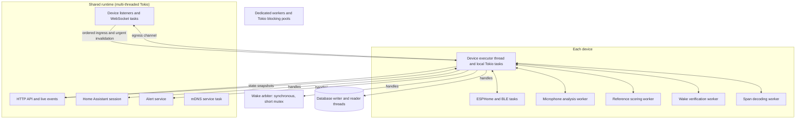

# A Rust controller: contracts, features and threading model

Status: design and implementation review for `controller-rs/`. The workspace runs the application and voice path described in §9.1; §9 records deployment and verification evidence.

## 1. What this document is

This document describes a new controller written in Rust, designed from first principles. It does not port or translate the Python controller's code, tests or fixtures. The sources of truth are the product requirements in this document, the external contracts other systems already depend on (the Go firmware, Home Assistant's published APIs, the dashboard, and data already on disk), and evidence recorded from real use. For three features the user asked for the deployed controller's exact behavior: pause transcription by a Wyoming server (§4.7), the completeness of the controller's own requests (§4.6), and local timer handling (§4.4). For those three, the Python controller was read to learn what it does, and the behavior is written into those sections as rules. Its code and structure were not copied, and where it had an evident bug, the intended behavior was implemented instead.

Everything in the current controller falls into one of three groups:

| Group | Meaning | Freedom |
|---|---|---|
| **External contract** | Something another system depends on: firmware already in the field, Home Assistant, browsers and scripts, or data already on disk. | Must stay compatible, byte for byte where noted. |
| **Product feature** | Behavior a user can see or rely on. | It must exist. How it is built, stored or tested is open. |
| **Internal** | Everything else: module layout, queues, types, timing constants and test structure. | Free, subject to the behavior and recovery requirements below. |

§3 lists the contracts and §4 the product features. §5 proposes the threading model and lifecycle. §6 specifies how speech behavior is defined and checked against recorded real sessions. §7 covers running the speech models from Rust, with measured results.

The companion document [`device-process-model.md`](device-process-model.md) proposes a Python design with one process per device. This Rust design replaces its process and IPC machinery, not its requirements for session identity, cancellation, privacy, durable operations and shutdown. Those requirements are included below.

## 2. Summary

- **Rust can remove most of the machinery the Python design needed.** Python needs one interpreter per device to run devices' Python code truly in parallel. That in turn needs a coordinator, an IPC protocol, socket relaying, shared memory and a supervisor. In Rust, each device can be a set of OS threads in one process. Rust ownership checks memory access; explicit identities and lifecycle rules still prevent logically stale work (§5).
- **All current models run from Rust** (§7):
  - Kroko ASR gave byte-identical results through the sherpa-onnx C API.
  - The BCResNet wake model gave bit-identical logits through the `ort` crate.
  - Silero VAD and DTLN also run, through `ort` or a direct implementation.
- **The contracts are large but well defined.** They are:
  - the device link (§3.1–3.2);
  - the Home Assistant integration (§3.3);
  - the HTTP API, which is kept unchanged so the existing dashboard works as it is (§3.4);
  - existing on-disk and HA-side data (§3.5);
  - the deployment surface (§3.6).

  Internal implementation is designed fresh within these contracts and the behavior requirements below. The existing database schema is a fixed external contract and its rows survive the cutover (§3.5); ordinary user changes and retention still apply.
- **The main risk is behavior, not code.** Voice quality depends on rules for endpointing, echo rejection, reply windows and arbitration. §4 states the required behavior; §6 defines how it is judged against recorded real sessions. §9 describes the delivery and acceptance steps.

## 3. External contracts

### 3.1 Device link, protocol v1

Firmware already in the field speaks this protocol, so the controller cannot change it on its own. A new capability is the only way to extend it (§3.1.9).

#### 3.1.1 Discovery and transport

| Item | Contract |
|---|---|
| Listeners | Plain WebSocket on `SERVER_PORT` (default 8767). TLS on `SERVER_TLS_PORT` (default 8770; 0 disables it). Both serve `/device/v1/control`, `/device/v1/audio`, `/device/v1/assets` and `/shell/{device_id}[?pty=1]`. Compression is off, and frames are limited to 10 MiB. |
| Discovery | The controller advertises an mDNS service `_emcontroller._tcp.local.` with instance `{MDNS_NAME}` (default `echomuse`) and host `{MDNS_NAME}.local.`. The record is IPv4 only and uses port `SERVER_PORT`. Its TXT is `version=1` and `server={MDNS_NAME}`, plus `tls_port=<n>` only while TLS is active. It is re-announced every 120 s. The advertised address is `SERVER_IP`, or else the address of the interface with the default route. An address that is not on any local interface's subnet gets no address record. |
| Device behavior the controller relies on | The device browses for that service, probes candidates with TCP and caches the last good controller. It uses `wss` only when it holds a CA file and the record has `tls_port`. It dials control first, then audio, then assets. |
| Socket pairing | The audio and asset sockets join the control socket's session through the `X-EM-Session` header. They must arrive on the same kind of listener (plain or TLS) as the control socket. An upgrade that matches no live session is refused with HTTP 403 *before* the upgrade. |
| Session lifetime | There is one live session per device. A new hello replaces the old session. Losing the audio or control socket ends the session. Losing the asset socket does not; the device redials it. |

#### 3.1.2 Authentication and TLS

- Every socket presents an `X-EM-Token` header. Tokens are random URL-safe strings stored per device. The comparison must be constant-time.
- Admission rules:
  - A token that is present but different from the stored one is rejected.
  - A missing token is allowed unless `REQUIRE_DEVICE_TLS` is set.
  - A token presented by a device with no stored token (one that was deleted) is allowed and ignored, and the device registers as pending.
  - With `REQUIRE_DEVICE_TLS`, the connection must be TLS and the token must match.
- The TLS directory (default `<DB dir>/tls`) holds `ca.pem`, `ca.key`, `server.pem` and `server.key`, all EC P-256. Devices pin the CA, so existing files must be loaded and kept. Creating a new CA would orphan every device that already trusts the old one. A missing or unusable server certificate is re-issued from the existing CA; a missing or broken CA beside other credential files is fatal, never replaced.
- The firmware verifies the server name `echomuse-controller` (`device/internal/client/tlscreds.go`) and requires TLS 1.2 or later. Certificates the controller creates use that name, run from 2000-01-01 to 9999-12-31 23:59:59 (the device's clock only rises to its build time), and are written with keys 0600 and certificates 0644.
- On the device, credentials live in `/data/local/etc/echomuse/ca.pem` (mode 0644) and `token` (0600). The device re-reads both on every dial.

#### 3.1.3 Envelope and timing

Each control message is one JSON text frame:

`{"protocol":1, "type", "session_id", "message_id" (uuid4), "device_id", "generation" (u32), "body"}`

- `session_id` is null only in `session.hello` and `session.rejected`.
- Unsigned 64-bit values travel as decimal strings.
- A control frame may be at most 256 KiB. A binary frame on the control socket is `malformed_message`.
- An unknown message type is ignored but still counts as a sign the link is alive. Unknown capabilities are kept and ignored.
- Heartbeats run every 1 s in both directions. A link is degraded after 2 s of silence and lost after 3 s. The device's heartbeat carries its monotonic clock in `mono_ns`.
- `clock.request {nonce}` is answered with `clock.reply {nonce, utc_ms}`.
- The hello must arrive within 10 s of connecting.
- A protocol violation is answered with `protocol.error {code, detail}` and the session closes. The codes include `unsupported_protocol`, `malformed_message`, `malformed_frame`, `oversize`, `wrong_session`, `wrong_device`, `unexpected_message`, `bad_stream`, `unknown_epoch`, `stream_ended`, `sequence`, `sample_order` and `unexpected_kind`.

#### 3.1.4 Handshake

**`session.hello`** (device to controller) carries:

| Field | Content |
|---|---|
| `capabilities` | The device's capability list. |
| `platform` | `fireos6`, `fireos6_crown` or `lineage18_crown`. Anything else is refused. |
| `firmware_version`, `os_version` | Stored with the device. |
| `protocols` | Must include 1. |
| `privacy` | `{muted, capture_epoch}` |
| `alerts` | `{delivery_epoch, acked_sequence, wakeup}` |
| `assets` | The SHA-256 of every installed asset. |
| `volume` | `{level 0..127 \| null, seeded}`. A null level means this run has no volume control. |
| `ambient_light_status` | Sensor status. |
| `boot_id`, `ip`, `clock` | Sent today but not used. |

**`session.ready`** (controller to device) carries:

- `protocol: 1`, `session_id`, `server_boot_id`, `capture_permitted` and `utc_ms`;
- `assets {runtime_sha256, graph_sha256, sidecar_sha256}`;
- `detector`:
  - `thresholds {idle, playback, near_miss}`;
  - the fixed values `hop_blocks: 2`, `smoothing: 3` and `clear_after_unscored: 6`, which the device refuses to run without;
  - `provisional_duck {duck_db, max_per_window: 2, window_ms: 5000}`;
  - optionally `open_rules` and `shadow_rules`, which are sent only to devices with `open_rules_v1`;
- `afe_metadata: true`, which is sent only to devices with `afe_metadata_v1`.

The device refuses a ready whose `protocol` is not 1 or whose `session_id` is empty or differs from a non-null envelope `session_id`. Every controller envelope after `session.ready` carries that session ID, or the device closes the session.

The runtime asset is the armeabi-v7a `libonnxruntime.so` from ONNX Runtime 1.19.2, pinned at SHA-256 `174233cf…`.

**`session.rejected {reason}`**, where the reason is one of:
- `protocol`: a required capability is missing, the platform is unknown, or the hello is malformed;
- `unauthorized`;
- `pending_approval`.

Every attempt, accepted or not, records the device's IP, firmware and OS versions and last-seen time. The provisioning wizard depends on that.

**Admission requires all eight protocol capabilities:** `audio_timeline_v1`, `uplink_leases_v1`, `device_wake_v1`, `render_reference_v1`, `render_progress_v1`, `focus_leases_v1`, `alert_cache_v1` and `turn_protocol_v1`.

A change to the wake graph, the open or shadow rules, or the near-miss floor must take effect through a new `session.ready`. Today the controller closes the link to force one.

#### 3.1.5 Message catalog

| Area | Device → controller | Controller → device |
|---|---|---|
| Acknowledgements | `command.ack {message_id, status: accepted\|applied\|durable\|rejected, error}` | `command.ack` for `wake.candidate` |
| Wake | `wake.candidate` (generation 1; must be acknowledged within 1 s or the device ends the candidate), `wake.candidate_end`, `wake.stats` (every 30 s; includes `shadow` and `afe`), `wake.near_miss` (with `near_miss_v1`) | |
| Audio streams | `stream.open`, `stream.end`, `uplink.ended` | `uplink.open`, `uplink.renew` (renewing it with `reason: "turn"` and the next generation converts a candidate into a turn), `uplink.close` |
| Playback | `render.progress`, `render.finished` | `render.start` (acknowledged), `render.end`, `render.cancel` |
| Focus | | `focus.acquire`, `focus.renew`, `focus.release` for `dialog_input` and `dialog_output`, each with a 3 s TTL renewed every 1 s |
| Alerts | `alert.ack`, `alert.local_operation`, `alert.ring_ended`, `alert.state` | `alert.snapshot`, `alert.delta`, `alert.op_result`, `alert.act`, `alert.ring`, `alert.prefetch` (with `alert_prefetch`) |
| Displays | | `turn.view` (with `turn_view_v1`), `timer.view` (with `timer_view_v1`, resent every second while any timer exists) |
| Hardware | `button.action`, `privacy.changed`, `volume_state`, `ambient_light` | `leds`, `led_anim` (12 LEDs), `volume_set {level}` |
| Device state | `stats` (every 30 s), `log`, `pong` | `config`, `ping` (every 5 s) |
| Wi-Fi and BLE | `wifi_result`, `wifi_scan_result`, `ble_adverts` | `wifi_change`, `wifi_commit`, `wifi_scan` (only with `wifi_control`) |
| Shell | | `shell_open {pty?}`, `shell_close` |

The message definitions are spread across `device/internal/proto/proto.go` and the firmware packages that produce their bodies. Generate Rust fields and fixtures from Go definitions where practical, but keep an explicit mapping from message type to body, required fields, ranges, nullable values and capability conditions, derived from `docs/protocol-v1.md` and the Go code. Check the resulting codecs against the Go implementation and captured exchanges. A comprehensive schema generator is not a prerequisite for starting.

These numbering rules are part of the contract:

- **Generations.** Candidate subscriptions start at generation 1, and converting one to a turn bumps it. Render frames and progress carry the playback's generation, and the device rejects a render that is older than a live one of the same class. Focus messages carry their owner's generation.
- **Alert delivery.** `alert.delta.sequence`, `alert.snapshot.high_water_mark`, `alert.ack.applied_through` and the hello's `acked_sequence` share one numbering within a `delivery_epoch`.
- **Button and mute events.** `physical_seq` increases within a session. The controller drops events whose number is not higher than the last one it saw.

#### 3.1.6 EMA1 audio frames

Each frame is a 64-byte little-endian header followed by its payload. The header fields are:

`magic "EMA1", kind, flags, channels (=1), format, epoch (≠0), sequence, first_sample, mono_ns, uncertainty_us (0xFFFFFFFF = unknown), sample_rate, frame_count, generation, source_mask, payload_bytes`

| Kind | Content | Maximum frames per packet |
|---|---|---|
| 1 mic | 16 kHz PCM16 | 1,280 |
| 2 reference | 16 kHz PCM16, or an empty payload flagged as digital silence. `source_mask`: content=1, alert=2, dialog=4, earcon=8. | 1,280 |
| 3 render (controller → device) | 48 kHz PCM16; `generation` is the playback's | 3,840 |
| 4 cells | 4-byte records: energy in centi-dB, flags, source mask; one per 512 samples | 320 |
| 5 afe | 14-byte records, one per 1,280 samples | 125 |

- The flags are: discontinuity 1, muted 2, underrun 4, estimated 8, digital silence 16.
- Each packet's epoch must have been announced by `stream.open` on the control socket, and sequence numbers must strictly increase within each stream epoch. The firmware adds exactly one per packet it sends.
- Header rules beyond the table: `generation` is 0 except in kind 3, and `source_mask` is 0 except in kind 2 (a digital-silence reference packet may carry one). Cell records and AFE records are validated as `device/internal/uplink` encodes them (loudness range, flags, mask, gap cells at −12000 centi-dB, AFE field bounds).
- Packets may go back in time only within a granted backfill run. The firmware queues one backfill run per subscription per stream, on that stream's current epoch, and sends queued runs one after another before live audio. The controller grants a run to a capture stream's own epoch, and to every open reference epoch, when a subscription starts wanting it.
- The device computes where a candidate's streams start, so these formulas are contract:
  - mic: `round_down(support_start − 4800, 512)`;
  - cells: 160,000 samples before the mic start;
  - reference: 40,000 samples before the mic start;
  - AFE: 40,000 samples before the mic start, rounded down to 1,280.

#### 3.1.7 Playback and focus

- **Network playback** (`content` and `dialog_output`):
  1. The controller chooses a random nonzero epoch and sends `render.start`.
  2. It waits for the device's acknowledgement before sending any audio frames.
  3. It streams 3,840-frame packets, starting at frame 0.
  4. It sends `render.end {end_frame}`, because frames may still be in flight on the audio socket.
  5. It keeps at most 258,304 frames ahead of the device's reported progress. The device's buffer holds 128 × 2,048 frames.
- **Local sources** (`earcon` and `alert_preview`) name an asset instead, and carry a null `epoch`. An `earcon` names `builtin:wake_chime`, `builtin:no_input_chime` (needs `no_input_chime`) or `builtin:announcement_chime` (needs `announcement_chime`). An `alert_preview` names `builtin:fallback` or an alert sound's SHA-256; the firmware rejects `builtin:fallback` as an earcon with `unknown_asset`.
- **Rejections.** The device can reject a render with `invalid`, `invalid_class`, `unknown_asset` or `stale_generation`.

#### 3.1.8 Alerts on the wire

- **Occurrence objects** have these fields: `due_local`, `due_utc_ms` (a string), `kind`, `label`, `loop_gap_ms`, `max_ring_ms`, `occurrence_id`, `ramp_ms`, `revision`, `schedule_id`, `snooze_ms`, `sound` and `volume`. The device refuses an object unless its IDs are lowercase UUIDs, `due_local` is RFC 3339, `due_utc_ms` is a non-negative decimal string, `label` is at most 120 characters, `max_ring_ms` is above 0, `volume` is in (0, 1] or null, and `sound` is `builtin:fallback` or a SHA-256.
- **Tombstones** are `{occurrence_id, revision, tombstone: dismissed|snoozed|expired|deleted}`.
- **Snapshots** are sent as pages of at most 128 objects, ordered by `(due_utc_ms, occurrence_id)`, and carry live occurrences only; a tombstone in a snapshot makes the device refuse it. Every page carries one SHA-256 computed over the canonical JSON of the whole ordered array, and **the device checks that digest**. So the canonical JSON form is part of the wire contract with the Go firmware.
- **The canonical form is kept as it is.** The firmware implements it in `device/internal/alerts/canonical.go`, with test vectors in `canonical_test.go`. The rules:
  - object keys sorted, no whitespace;
  - strings are UTF-8, and only `"`, `\` and control characters below 0x20 are escaped;
  - integers are written as exact decimals;
  - floats use the shortest digits that round-trip, positional notation for decimal exponents from −4 up to 15, and otherwise `d.ddde±XX` with at least two exponent digits (`1e+16`, `1.234e-05`);
  - `-0.0` stays `-0.0`, and NaN or infinity is rejected.

  The device re-encodes the objects it receives with these rules before hashing, so a float's text on the wire does not matter, only its value. The Rust controller implements the same rules and must pass the Go test vectors. A Rust JSON library's default output is not acceptable here; for example, it writes `1e16` rather than `1e+16`. If the form ever has to change, it changes in a firmware release and in the controller together.
- **Resync.** A snapshot is sent at hello unless the device's epoch and acknowledged sequence both match. An `alert.ack` with `need_snapshot` asks for another.

#### 3.1.9 Assets, shell and capabilities

- **Asset socket.** The device sends a text request `{sha256, offset}`, and only one may be outstanding at a time. The controller answers with binary chunks of at most 64 KiB, then a text frame `{sha256, size, done: true}`, or `{"error": "not_found"}`. A served file must hash to its name.
- **Shell.** After `shell_open`, the device dials back to `/shell/{device_id}` and connects a shell.
  - In pipe mode, both directions carry raw bytes.
  - In PTY mode, a controller-to-device frame is either `0x00` followed by input bytes, or `0x01` followed by columns and rows as big-endian u16.
  - The device keeps one shell at a time, and the shell survives a control reconnect.
- **Optional capabilities.** The firmware may announce:
  - hardware: `leds`, `led_anim`, `buttons`, `button_hold`, `ambient_light`;
  - alerts and chimes: `alert_prefetch`, `local_wake_chime`, `no_input_chime`, `announcement_chime`;
  - wake and evidence: `open_rules_v1`, `near_miss_v1`, `afe_metadata_v1`;
  - Dot only: `wifi_control`, `ble_proxy`, `privacy_mute`;
  - Echo Show: `screen_wake`, `screen_overlay`, `turn_view_v1`, `timer_view_v1`, `kiosk_plugin`.

  The controller negotiates by capability and never by version string. A control whose capability is missing is shown disabled with a reason (§4.10).
- **New firmware features need a new capability.** One example is a binary firmware upload channel to replace the shell transfer in §3.2.

### 3.2 Provisioning and firmware delivery

Devices already in the field can only be updated through the shell, so this path is a contract until all of them run firmware with a better channel.

- **Install layout.** The firmware lives in `/data/local/bin/server_a` and `server_b`, and `server` is a symlink to the active one. `/data/local/bin/start_server.sh` runs and supervises it.
- **File transfer** uses the shell:
  1. Probe that `base64 -d` and `md5sum` work.
  2. Write the data to `<dest>.part` through a base64 heredoc ending at the delimiter `__END_B64_42__`, and wait for `TRANSFER_OK`.
  3. Compare the md5, then `mv` the file into place and look for `VERIFY_OK` (or `VERIFY_BAD:<md5>`).

  The target is never deleted first, because it may be the rollback slot. The device has only toybox and mksh.
- **Update.**
  1. Upload the new binary to the inactive slot.
  2. Run `ln -sf <slot> /data/local/bin/server && kill $PPID`.
  3. Wait for a reconnect that reports the new firmware version.

  If the device comes back on the old version, `start_server.sh` rolled it back after three failed starts, and the controller reports an automatic rollback. **Rollback** flips the symlink back the same way.
- **`start_server.sh`** (in `controller/device_payloads/`) is synced by md5 on every update. Its `debloat` mode prints result lines (`DEBLOAT_STOPPED:…`, `HIDE_REASSERTED:…`, `MIC_REASSERTED:…`) that the controller parses.
- **Echo Show package lists.** Three files are synced to `/data/local/etc/echomuse/`: `crown_hide_packages.txt`, `crown_hide_packages_tier2.txt` and `crown_mic_deny_packages.txt`.
- **Secure link.** The controller writes `ca.pem` and `token` to the device, then disconnects it so it redials over TLS.
- **Wizard endpoints.** The provisioning wizard (which runs in the dashboard over WebUSB adb) calls `GET /api/provision/start_script`, `GET /api/provision/crown_lists`, `GET /api/provision/firmware` (with the `X-Firmware-Version` and `X-Firmware-Sha256` headers), `POST /api/provision/tls_credentials` and `POST /api/provision/diagnostics`. It identifies a device by `ro.serialno`, which equals the hello's `device_id`. The boot hook files (`echomuse.rc` for each platform, plus the LineageOS `addon.d` script) are currently embedded in the dashboard source. Their bytes are part of the contract wherever they end up.
- **Bundled firmware.** `FIRMWARE_DIR` holds `server` and `version`. The controller verifies their hash at startup and refuses to serve a binary that has changed since then.

### 3.3 Home Assistant

#### 3.3.1 ESPHome voice satellite (one server per device)

Home Assistant's device and entity registries key on these values, so changing any of them would make HA see a new device.

| Item | Contract |
|---|---|
| Protocol | Plaintext ESPHome native API only (a Noise preamble is rejected). Frames are limited to 65,535 bytes. The server reports API version 1.10 and never asks for a password. Messages follow the protobuf schema of aioesphomeapi 45.3.1, which has 148 message types. |
| Node name | `echomuse-` + the last 12 characters of `device_id`, lowercased. |
| MAC | The hex characters of `device_id`, last 12, left-padded with `0`, uppercase, separated by colons. |
| Device info | `friendly_name` "`{label} Voice Assistant`", manufacturer "EchoMuse", a model for each platform, `project_name` "EchoMuse.`{model}`", `project_version` (`ESPHOME_PROJECT_VERSION`), and voice-assistant feature flags 61 (voice assistant, API audio, timers, announce, start conversation). |
| Ports | Allocated from 16001 upward and never reused. Each device keeps its port, because HA's config entries store host and port. |
| mDNS | `_esphomelib._tcp`, instance `{node}`, TXT keys `version`, `friendly_name`, `mac` (12 lowercase hex characters), `network=ethwifi`, `project_name` and `project_version`. The record exists for every approved device; the listener exists only while the device is connected. |
| Entities (fixed keys) | 1: `media_player` (pause, volume, mute, play media, stop, play, browse, announce; FLAC at 48 kHz mono). 2: `event` `action_button` with types long, single, double and triple (only with `button_hold`). 3: `sensor` `ambient_light` in lx (only with `ambient_light`). 4: `binary_sensor` `alert_ringing` (device class sound). 5: `button` `stop_alert`. 6: `text_sensor` `voice_state` (idle, listening, thinking or speaking). |
| Incoming requests | Media commands: play a URL, play an announcement, pause, play, stop, set volume. The stop button. `VoiceAssistantAnnounceRequest`: play the preannounce chime and the announcement, and start a conversation if asked. Timer events (started, updated, cancelled, finished). |
| Controller-started runs | A `start_conversation` reply is sent as `VoiceAssistantRequest(start, flags=0)`, then 640-byte audio chunks and an empty chunk marking the end. HA's events are mapped to STT, intent, TTS and error results. |

Volume crosses as HA 0–1 ↔ device 0–127 (`round(v·127)`). Ordinary wake and button turns do **not** use the ESPHome voice path. They use Assist pipeline runs (§3.3.3).

#### 3.3.2 Bluetooth proxy (Dot only, optional)

- It is a separate ESPHome device on port = voice port + 1000.
- Node name `echomuse-<12>-bt`.
- MAC: the voice MAC with the first octet XOR 0x02.
- Bluetooth proxy feature flags 33 (passive scan and raw advertisements).
- One diagnostic sensor, `ble_advertisements`.
- Advertisements from the device's `ble_adverts` are forwarded as `BluetoothLERawAdvertisementsResponse` while HA is subscribed.
- It exists only when `bleProxyEnabled` is set and the device has `ble_proxy`.

#### 3.3.3 Home Assistant API usage

**Connection.**
- The connection uses `HA_URL` with an **administrator** `HA_TOKEN`.
- Add-on mode uses `SUPERVISOR_TOKEN` with `ws://supervisor/core/websocket` and the REST base `http://supervisor/core/api` instead.
- Setting only one of `HA_URL` and `HA_TOKEN` is a configuration error naming the missing one; it does not fall back to the Supervisor token. A refused token stops the session rather than retrying, because Home Assistant counts failed logins toward an IP ban.

**WebSocket commands:**
- `get_config`;
- `subscribe_events` and `unsubscribe_events`;
- `fire_event`;
- `call_service` (`script.reload`, `select.select_option`);
- `assist_pipeline/pipeline/list`, `assist_pipeline/pipeline/get` and `assist_pipeline/run`;
- `conversation/agent/homeassistant/debug` and `conversation/sentences/list`;
- `config_entries/get`;
- the entity, device, area and floor registry list commands;
- `homeassistant/expose_entity/list` and `homeassistant/expose_entity`;
- `calendar/event/create`, `calendar/event/update`, `calendar/event/delete` and `calendar/event/subscribe`.

**REST calls:**
- `POST /api/intent/handle`, for `HassTimerStatus`, `HassCancelTimer` and `HassCancelAllTimers`;
- `GET /api/states/{entity}` and `GET /api/calendars/{entity}`;
- the config-entry flow that creates a Local Calendar;
- `GET` and `POST /api/config/script/config/{id}`;
- fetching TTS proxy URLs.

**Assist pipeline runs:**
- **STT only.** The audio goes as binary frames prefixed with the handler byte HA assigns. One retry is allowed after a transport failure, because STT has no side effects.
- **Intent to TTS.** Never resent once dispatched; a lost run has an unknown outcome.
- **TTS only**, for the controller's own spoken lines.
- **Device and pipeline.** Each run carries the satellite's HA `device_id`, found by matching the MAC in HA's device registry. It uses the pipeline chosen by the satellite's pipeline select. The controller also sets the satellite's VAD sensitivity select to `relaxed`.

**Operations that change state.** The no-resend rule also applies to direct `/api/intent/handle` calls, including timer cancellation, and to an unanswered `alert.act`. Distinguish failure before dispatch, confirmed rejection, confirmed success and an unknown outcome after possible dispatch. Cancelling a turn withdraws interest and rejects late replies; it does not undo an action HA or a device may already have performed. Only operations covered by the alert journal's existing idempotency rules are recovered by retrying, with their original operation IDs and request digests. Never turn an uncertain ordinary intent into a new request.

**Events.**
- Subscribed: the four registry-updated events (for vocabulary), `automation_reloaded`, conversation and automation `call_service` events (for trigger sentences), and `echomuse_alert_request` (the LLM relay).
- Fired: `echomuse_alert_result`.

**Startup probe.** Each of these features is checked separately, and a failure disables only that feature: `voice`, `calendar`, `scripts`, `vocabulary`, `timers` and `recognizer`. The results are shown on the dashboard.

#### 3.3.4 Data the controller keeps inside Home Assistant

- **A Local Calendar for each speaker**, titled "EchoMuse `{label}`".
  - Alarm events are one minute long, with times in HA's time zone.
  - Repeating alarms use `FREQ=DAILY`, or `FREQ=WEEKLY;BYDAY=…`.
  - The last line of the description is `echomuse: ` followed by canonical JSON with exactly these keys: `id`, `kind`, `loop_gap_ms`, `max_ring_ms`, `op`, `parent`, `ramp_ms`, `snooze_ms`, `sound`, `v` (=1) and `volume`.
- **Identifiers** are UUIDv5 values derived from fixed namespaces and strings:
  - an occurrence: `uuid5(schedule_id, key)`;
  - a snooze child: `uuid5(URL, "echomuse-snooze:" + parent occurrence)`;
  - a missed occurrence: `uuid5(URL, "echomuse-missed:" + occurrence)`;
  - an event created in HA's UI: `uuid5(URL, calendar/uid)`;
  - a voice alarm operation: `uuid5(URL, origin_turn_id)`, retaining the original asking turn across AM/PM clarification;
  - a local alert action: `uuid5(URL, turn_id + "|" + action)`;
  - a new schedule: `uuid5(op_id, "schedule")`;
  - a group cancellation: the root operation ID for the first target, then `uuid5(root_op_id, schedule_id)` for each remaining target;
  - an LLM relay operation: `uuid5(URL, request_id)`.

  The device caches these IDs and the journal stores them, so the formulas cannot change.
- **Five scripts:** `echomuse_set_alarm`, `echomuse_list_alarms`, `echomuse_cancel_alarm`, `echomuse_dismiss_alert` and `echomuse_snooze_alarm`.
  - They are exposed to the conversation assistant.
  - Each fires `echomuse_alert_request` and waits up to 10 s for `echomuse_alert_result`.
  - The controller records a hash of each script it installed, so it can tell whether the user edited one. If the user did, the controller leaves that script alone.

### 3.4 HTTP API

The dashboard ships with the controller, so the API it uses can change as long as the dashboard changes with it. Two groups of callers sit outside our control:

- **Scripts that record audio** use these routes:
  - `GET`/`POST /api/devices/{id}/capture`;
  - `POST …/capture/window` and `…/capture/window/stop`;
  - `GET …/capture/recording`, a long poll.

  They also rely on webhook deliveries: a POST of WAV data with these headers:
  - `X-EM-Device`, `X-EM-Session`, `X-EM-Tag`;
  - `X-EM-Ms`, `X-EM-Peak-Db`, `X-EM-Floor-Db`;
  - `X-EM-Frames`, `X-EM-Dropped`, `X-EM-Truncated`, `X-EM-Opened-Ms`.

  Redirects are refused.
- **Login and setup**, which browsers and the add-on use:
  - `POST /api/setup` with the bootstrap token that is printed at startup while no user exists;
  - `POST /api/auth/login`, which returns `{token, role}`;
  - Bearer tokens on HTTP, and `?token=` or the `session` cookie on WebSockets;
  - the `admin` and `readonly` roles;
  - existing bcrypt `$2b$` password hashes must still verify.

**Decision: keep the dashboard API.** The new controller serves the existing dashboard routes, JSON shapes and `/api/events` messages unchanged, so the dashboard ships as it is. The API is therefore a contract for this rewrite, like the device link. The current routes cover these features:

| Feature | Routes (prefix `/api`) |
|---|---|
| Setup and auth | `setup`, `system/setup-state`, `auth/login`, `auth/logout`, `auth/me`, `auth/change-password` |
| Devices | `devices`, `devices/pending`, `devices/{id}` (GET, PATCH, DELETE), `…/approve`, `…/config` (GET, POST), `…/kiosk_login`, `…/logs` |
| Turns and activity | `turns`, `near_misses`, `devices/{id}/turns`, `…/near_misses` (and PATCH for a verdict), `…/activity`, `…/wake_shadow`, `…/response_latency`, `…/turns/{turn}/{audio,recording,wake,afe,trace}`, `…/near_misses/{nm}/{recording,afe}` |
| Archives | `devices/{id}/wakeclips.zip`, `devices/{id}/samples.zip`, `wakeclips.zip`, `near_misses.zip`, `clip_windows` |
| Recording modes | `devices/{id}/collect`, `…/samples[/{name}[/afe]]`, `…/ambient[/{name}[/afe]]`, `…/wakeclips` (DELETE), `…/capture…` |
| Device management | `devices/{id}/wifi`, `…/wifi/scan`, `…/update`, `…/update/queue`, `…/rollback`, `…/secure_link`, `…/debloat`, `…/shell` (WebSocket), `firmware`, `firmware/deploy`, `releases/controller`, `provision/*` |
| Models, sounds, alerts | `wake_models` (GET, upload, DELETE), `devices/{id}/speech_assets`, `sounds` (GET, upload, DELETE), `devices/{id}/sounds/{preview,stop}`, `devices/{id}/alerts`, `…/alarms`, `…/alarms/cancel` |
| Configuration and system | `global/config`, `system/status`, `system/config`, `support/bundle`, `ha/status`, `speech/wyoming`, `text_fix/trial`, `text_fix/unknown_words` |
| Live updates | `WS /api/events`: a snapshot on connect, then device updates, logs, connection changes, approval, deletion, firmware update progress, controller update, `turn_complete`, alert notices and `ha_status` |

**Add-on ingress.** With `ECHOMUSE_HOME_ASSISTANT_INGRESS=true`, only requests from `172.30.32.2` are served. The `X-Ingress-Path` header is written into the page as `<base href>`, so every dashboard URL must be relative.

### 3.5 Existing data

A user's existing installation must keep working after the switch. The database and the files beside it hold users' devices, credentials, history, alarms and recordings, so they are kept exactly as they are.

#### 3.5.1 The database schema is a fixed external contract

These rules are requirements for the whole rewrite and the cutover, not preferences.

1. **Use the same SQLite file and the same schema.** The Rust controller opens the database at `DB_PATH` in place. The schema is the one deployed today at `schema_version` 40: 14 tables (`devices`, `users`, `sessions`, `system_config`, `turns`, `near_misses`, `device_logs`, `device_metrics`, `wake_counters`, `wake_shadow`, `wake_shadow_events`, `alert_ops`, `alert_delivery`, `alert_scripts`) and 8 indexes. Its definition is `controller-rs/crates/db/schema/v40.sql`, read from a real deployed database (schema only, no rows). It is regenerated only by reading a real database, never by hand or from controller code. The Rust controller does not introduce a new schema, copy data into a new database, or run an importer.
2. **Require the contract version.** A database at `schema_version` 40 whose tables and indexes match the contract is opened. A lower version is refused and needs an explicit migration on a private copy or a compatible backup; Rust carries no historical migrations and never starts Python to perform one. A higher version is refused with the instruction to restore a backup or run a newer controller. A schema that does not match the contract is refused with a precise report, never written into.
3. **Fresh installations** get the contract schema and their initial `system_config` rows in one transaction. Initial values are a product decision recorded in the database crate (for example `device_approval` created as `strict`, ESPHome ports allocated from 16001).
4. **Do not delete, rewrite or reset data to cut over.** Every existing row stays where it is with the same row ID, including devices, tokens, ports, users, password hashes, sessions, system settings, turns, near misses, logs, hourly rollups and the alert journal. Recording files are named by row ID (§3.5.2), so IDs must never be renumbered. Ordinary updates, user-requested deletion and retention still apply.
5. **Write values the way the existing data is shaped.** New rows and updates keep each column's meaning, units, JSON shapes and text encodings as they appear in real data. Where a column's encoding is not stated in this document, it is determined from real data and recorded in the database crate. NULL means "unknown" or "absent" and is never replaced by zero or an empty value. A column the Rust code does not use is preserved, not dropped or cleared.
6. **Back up before the first write.** Before its first write to an existing installation, the Rust controller creates `<DB_PATH>.pre-rust.bak` through SQLite's online backup API. Publish it atomically and never overwrite a completed one on restart or after rollback. If it cannot be written, refuse to start.
7. **Connection settings.** WAL journaling and `foreign_keys=ON`.
8. **Schema changes.** The first Rust release changes no schema, so the previous Python image can still open the database. A later schema change is a deliberate versioned step (41 onward) owned by the Rust controller, and ends rollback to Python past that point.
9. **Recovery during the cutover.** Checking the schema alone does not establish compatibility for every value or journal transition. The copied-installation check proved that the saved Python image can read Rust-created turns and recordings, but pending alarm operations need manual recovery (§9.3.2). The user accepted that exception and subsequently chose Rust as the only normal runtime (§9.5). An explicitly selected previous image can still be checked on a copy; Python is not an automatic fallback.
10. **Never test against a live database.** Development and tests use copies; committed fixtures never contain real rows.

The alert journal deserves a specific note. Pending alert operations are retried with their original `op_id`, and the journal stores a digest of each request's canonical JSON. Because the canonical form is kept (§3.1.8) and the rows are untouched, a retry of a pending operation still matches its row.

#### 3.5.2 Files beside the database

- **Recordings.** These files are named by database row ID:
  - `recordings/<device>_<id>.wav`
  - `turn_recordings/<device>_<id>.wav`
  - `nearmiss_recordings/<device>_<id>.wav`
  - `wakes/<device>/<id>.wav`

  Because row IDs are preserved (§3.5.1), these names stay valid. They are never renamed or moved.
- **Other files**, which are also kept as they are:
  - `samples/<device>/` and `ambient/<device>/`: WAV files with optional `.afe.json` sidecars; an unfinished ambient recording is a `.wav.part`.
  - `sounds/`: uploads, `.alert.json` export records, and `sounds/assets/<sha256>.wav`. Calendar events name these assets by hash, so they are never deleted.
  - `oww_models/registry.json` plus content-addressed graph and sidecar files.
  - `tls/`.

**Publishing recordings.** Commit the metadata row and obtain its stable ID first. Write the WAV and any AFE sidecar through temporary files and atomic renames, off the device's event loop. Mark the recording saved only after all required files exist. A crash may leave an unsaved row or an orphan file, never a row advertised as saved before its files exist. Recovery reconciles those cases using the existing names and formats. Retention and device deletion must coordinate with in-progress publication so a late writer cannot recreate deleted data.

### 3.6 Deployment

- **Environment variables:**
  - network: `SERVER_HOST`, `SERVER_PORT`, `SERVER_TLS_PORT`, `API_PORT`, `SERVER_IP`, `MDNS_NAME`, `REQUIRE_DEVICE_TLS`;
  - Home Assistant: `HA_URL`, `HA_TOKEN`, `SUPERVISOR_TOKEN`;
  - paths: `DB_PATH`, `TLS_DIR`, `FIRMWARE_DIR`, `SPEECH_BUNDLE_DIR`, `ORT_ANDROID_LIB` (served to Dots), `ONNXRUNTIME_LIB` (the controller's own pinned ONNX Runtime 1.20.1 library), `NS_MODEL_DIR`, `DEVICE_PAYLOADS_DIR` (`start_server.sh` and the Echo Show package lists, default `/app/device_payloads`);
  - other: `ESPHOME_PROJECT_VERSION`, `ECHOMUSE_HOME_ASSISTANT_INGRESS`, `DEVICE_APPROVAL`, `EM_CONTROLLER_VERSION`. (`EM_SKIP_DB_BACKUP` only skipped migration backups; the Rust controller runs no migrations and never skips its cutover backup.)
- **Home Assistant add-on.** The add-on's options are `server_host`, `server_ip`, `mdns_name`, `esphome_project_version`, `require_device_tls` and `device_approval`. They are read from `/data/options.json` and mapped to the environment variables above; a variable that is already set wins. The add-on requires host networking and `homeassistant_api`.
- **Image.** Published for `linux/amd64` and `linux/arm64`. It carries the bundled firmware, the speech bundle, the Android ONNX Runtime library served to Dots, the DTLN models and ffmpeg.

## 4. Product features

These must exist in the new controller. How they are built is open. Values marked *(tuned)* came from field tuning, and a redesign should keep them unless it has evidence for a better value. The summaries here do not replace the behavioral fixtures and evidence rules in §6.1.

### 4.1 Wake word

- **Refused at arrival** when the candidate is malformed, a diagnostic recording is active, speech is unavailable, the device is muted, or another candidate is already pending. Each case is reported to the device with its own reason.
- **Device quiet:** accept on the device's score alone.
- **Device making sound:** decide from three pieces of evidence: whether the mic audio is only the device's own output (echo), whether the device's own output contained the wake word (reference scoring), and an ASR check of the wake phrase. Refuse as `self_output`, `echo_only`, `unverified_wake` or `verifier_timeout`. The verification audio runs from 300 ms before support start to 480 ms after the candidate opened *(tuned)*. Keep today's 700 ms decision budget as the initial behavior; it can change deliberately with the deadline fixtures and documented expected outcomes in §6.1, not as an incidental consequence of new scheduling.
- **Wake word removed from the text** sent to HA, but kept in recorded audio.
- **Refused wakes** are persisted with their reason, a decision trace and, optionally, their audio.

### 4.2 Several devices hearing one wake

- The first device to claim within `wakeArbitrationMs` (default 700 ms; 0 disables it) takes the turn, and the others stand down without waiting.
- Context changes the rule:
  - A wake that interrupts the device's own audible reply skips arbitration.
  - An alert-context wake claims like any other; the winner acts on the ring wherever it sounds.
  - A media-context loser may still pause or stop its own media.
  - With no context, a loser is refused as `arbitration_lost`.
- "Stop" said near a device while exactly one other device rings stops that ring.

### 4.3 Button

- A hold of 750 ms or more sends HA the `long` event, even while muted.
- An optional tap event (`buttonSingleTapEvent`), with multi-tap detection in a `buttonMultiTapMs` window, sends `single`, `double` or `triple`.
- A tap during a turn cancels it. Otherwise a tap starts a turn from 300 ms before the press.
- A press the device already used to stop an alert is ignored.

### 4.4 Commands handled without HA

- **Right after a wake, with context:**
  - while an alert rings: "stop", "cancel" or "snooze", or a named "stop the pasta timer";
  - while the device's own reply plays: "stop";
  - while media plays: "stop" or "pause".

  These run before STT. Stopping or snoozing a ringing alert says nothing: the sound stopping is the answer. Only an `alert.act` whose outcome is unknown is answered, with "I'm not sure that worked."
- **After STT, tried in this order:**
  1. **Repeat:** replay the last answer if it ended within 120 s.
  2. **Set or cancel an alarm,** with times, days and repeats, and an "AM or PM?" prompt when it is unclear.
  3. **Alarm queries.**
  4. **Cancelling timers on this speaker:** "cancel the timer" and "cancel all timers" (below).
- **Every other request** goes to HA's own intent handling.

The local grammar reads Home Assistant's own English intent templates (home-assistant-intents 2026.7.30, the release HA 2026.8.1 pins, read with hassil 3.11.0 template semantics) and the controller's own; which requests it judges for completeness, and how, is §4.6. Every line below is the deployed controller's, word for word, except where a difference is named.

**Timers.** HA owns every timer, and its own timer intents answer every timer request but two. Setting a timer, "how much time is left", "what timers do I have", adding or removing time, pausing, resuming, and cancelling a timer named by its name or length ("cancel the pasta timer", "cancel the 10 minute timer") go to HA like any other request, with the satellite's HA device, and HA's answer is played. HA's built-in sentences miss several of these phrasings ("how much time is left" needs "…on the timer"), so the HA configuration adds custom sentences for them (`custom_sentences/en/timers.yaml`, `docs/post-afe-audio-architecture.md` §10.8). The deployed controller relies on them: in its field turns 454, 711, 921 and 924, "how much time is left" went to HA, which matched its custom template and answered, for example, "Your 12 minute timer has 6 minutes and 31 seconds left."

The controller decides the two cancels whose answer from HA could not say which timer went:
- **What it reads.** HA's timer list (`HassTimerStatus` through `POST /api/intent/handle`, with the satellite's device; it changes nothing). Only the timers HA lists under this satellite's HA device are this speaker's. The ESPHome timer events feed the display copy (§4.9), never these decisions.
- **"Cancel the timer"** (cancel, stop, turn off, delete, remove, end or clear; "the", "my", "this" or "that"; "please" and "can you" are ignored):
  - none: "You don't have any timers."
  - one: one `HassCancelTimer` whose slots (the name, and the start units the timer was given) pick exactly that timer by HA's own search (by name, then the start units, then the asking device): "2 minute timer cancelled.", "10 minute pasta timer cancelled." When HA could not pick it out (another of this speaker's timers has the same length and name), nothing is sent: "You have 2 10 minute timers, and I can't tell them apart. Say cancel all timers to cancel them."
  - several: "Which one? Your 5 minute timer or your 10 minute pasta timer?" (more than five: "You have 6 timers. Which one? Say its length, like the 5 minute timer."), with a reply window. The answer may be a length ("the 10 minute one", "10 minutes", "my 10 minute timer"), a name ("the pasta one"), both ("the 10 minute pasta timer"), a position ("the second one", "the last one"), all of them ("both", "all of them", "every timer"), a whole cancel ("cancel the 5 minute timer", "cancel both timers"), or no ("never mind", "neither", "leave them"). A length or a name two of the offered timers share picks neither. The timers are listed again and the chosen one is cancelled as above; one that finished meanwhile: "Your 5 minute timer already finished." An unclear answer: "Which timer? Say its length, like the 5 minute timer, or say all of them."; a second: "Okay, I left it."; no: "Okay, I left it."
- **"Cancel all timers"** ("cancel every timer", "cancel both timers", "cancel my timers"): when every timer in HA is this speaker's, one `HassCancelAllTimers`; otherwise one `HassCancelTimer` per timer, one after another, skipping those HA could not pick out. "5 minute and 10 minute timers cancelled." (more than five: "6 timers cancelled."); some not cancelled: "5 minute timer cancelled. 1 could not be cancelled."; none cancelled: "I couldn't cancel that timer."; none running: "You don't have any timers."
- **How timers are said:** the start length in digits with singular units, then the name: "1 hour 30 minute pasta timer".
- **Failures.** A cancel HA refused (it no longer finds the timer) or that was never sent counts as not cancelled. A cancel that may have reached HA without an answer is never re-sent: the rest are not sent, and the turn ends `outcome_unknown` with "I'm not sure that worked." (§3.3.3). When HA cannot list its timers, the request goes to HA's own intent handling as an ordinary request; for the answer to "Which one?" the turn ends `ha_error` with "Something went wrong." A speaker whose HA device is unknown cancels nothing: "I couldn't cancel that timer." (the deployed controller then counted the timers HA lists without a device as the speaker's).
- **Turn row.** `outcome` is `timer` (`clarification` for the "Which one?" turn and for an unclear or declined answer), `intent_ms` the time of HA's timer list, `response_type` HA's from it (`action_done`), and `intent_local` NULL: no HA agent answered. A request that falls back to HA is an ordinary HA turn. The controller's other own answers (alarms, repeat, alert commands) leave `intent_local` NULL too.

**Alarms.** Times are said as "7 AM", "6:30 PM", "12 PM" and "12 AM"; days as "today", "tomorrow", "on Friday" within the week and "on November 12" beyond it; repeats as "every day", "on weekdays", "on weekends" or "on Mondays and Wednesdays".
- Set: "Alarm set for 7 AM tomorrow." (a labelled alarm, which only this controller parses: "Work alarm set for 6:30 AM on weekdays."). Journaled but not yet confirmed by HA: "I'm still saving your alarm for 7 AM tomorrow. It isn't confirmed yet." (the deployed controller said "Alarm set" here, which §4.9 forbids). A date that does not exist, which only this controller parses: "That date doesn't exist."
- Questions: "You have 1 alarm: 7 AM tomorrow.", "You have 3 alarms: 7 AM tomorrow, work at 6:30 AM on weekdays, and a snoozed alarm at 7:09 AM today." (more than five: the first five, then "and 2 more"); "Your next alarm is 7 AM tomorrow."; "You don't have any alarms."; the list unreadable: "I couldn't check your alarms."
- Cancel: "Alarm cancelled." or "Cancelled 2 alarms."; nothing matching, or no alarms: "I couldn't find that alarm."; several and no time said: "Which alarm? Say its time.", with a reply window that takes a time, a position or "all of them" (the deployed controller opened no window: the user asked again with the wake word). A cancel still pending: "I'm not sure that worked." (the deployed controller said "Alarm cancelled.").
- Any other failure (HA unavailable, its time zone unknown, a time already passed, a refused write): the turn ends `ha_error` with "Something went wrong."

The other fixed lines:
- "Sorry, I didn't catch that."
- "That was too long. Try a shorter request."
- "Something went wrong."
- "I'm not sure that worked."
- "AM or PM?" and "Please say AM or PM."
- "Okay, I left it."
- "I haven't said anything in the last two minutes."

### 4.5 Follow-up replies

- **What opens a reply window:**
  - HA's `continue_conversation`;
  - the controller's own questions (AM/PM, which timer);
  - "didn't catch that" after an empty or unreliable transcript.

  The window listens without a wake word.
- **Chain limits:** at most 5 replies and 60 s *(tuned)*.
- **Window timing:**
  - The window opens after the question finishes playing, with a 320 ms guard, and a chime when `wakeSound` is on *(tuned)*.
  - An answer that starts while the question is still playing (early answer) cancels the question.
  - A silent window closes after 7 s *(tuned)*.
  - A wake or button press during the window keeps the question's context.
- **HA announcements** queue behind the device's replies. An announcement with `start_conversation` opens an HA-driven reply window through the ESPHome path.

### 4.6 Knowing when the user has finished speaking

- **The turn is analysed in 32 ms cells.** Each cell is classified as gap, the device's own output, non-speech, background speech, command speech or unknown.
- **It is looked at after every mic packet.** The streaming recognizer's result, the pause decode and the endpoint are evaluated when each mic packet of the turn is complete, not every 80 ms from the utterance start. The device sends at most 1,280 samples (80 ms) per packet: a wake candidate's backfill from the subscription's mic start, then live audio from where its ring stood when the subscription began, which on an Echo Dot is the absolute 1,280-sample grid. Every block boundary in the deployed controller's stored wake turns (2,129 pause, answer and decision samples in 274 turns) lies on those packet ends. Mic already held when the utterance starts (a wake verified before it was accepted) is read as one block, and its VAD never arms the pause decode: none of the deployed controller's verified wakes made a pause decode within ten blocks of the trigger. A wake utterance starts at `support_start − 4800`, not rounded to a cell like the mic stream, as in every stored wake turn.
- **Pause endpoint.** The silence needed after the command depends on whether the text looks complete. It is 608 ms for complete text, 1,216 ms for text that could be extended, and 1,792 ms for text that clearly needs more *(tuned)*.
- **Background speech endpoint.** When a complete command is followed by background speech, such as a TV, the turn ends where the command ended.
- **Commit.** There is a 192 ms lookahead before committing, and further command speech revokes the endpoint *(tuned)*. The commit carries the text and class in force when its end was decided: words that arrive during the lookahead (a pause server's answer) are recorded as judged but change neither, and HA's matcher is asked about such words only on a block that does not commit. The deployed controller did exactly this in all six field turns where differing server words arrived in the lookahead (688, 755, 852, 953, 811, 832): it committed Kroko's words each time, asked HA about the new words when they came before the commit block (688, 755, 852) and never when they came on it (811, 832). The committed audio ends at the later of the last command-speech cell plus 192 ms and the streaming recognizer's last emitted command word plus 64 ms, so soft final words are not clipped. Only words emitted by the decision's evidence frontier count. The 64 ms margin is measured: on 190 real wake turns Kroko emitted the last word a median 136 ms after that word's audio ended, and 64 ms covers the 90th percentile; it cut final words in 1 of 150 commits instead of 6 *(tuned)*.
- **Limits:**
  - 5 s with no command speech ends the turn as no input;
  - an utterance may last 15 s, or 30 s with `extendedUtterances` *(tuned)*;
  - a 3 s no-progress fallback applies.
- **Completeness.** These are the deployed controller's rules, checked against every text its field traces judged (§9.1). The judged text is the stable prefix, or the pause server's words (§4.7), as lowercased words, a word being a run of letters, digits and apostrophes: "three-minute" is "three minute" and "5:30 p.m." is "5 30 p m". HA's matcher is asked about exactly that text. The local grammar judges only its own requests, and the strongest class any of them gives wins:
  - **Timers** (HA's timer templates, plus "how much time [is] left" and "set a <name> timer for <length>", which those templates lack) and **the controller's own commands** (a bare stop, cancel, snooze or pause; stopping a ringing alert; alarms; alarm questions; cancelling timers; repeat). A whole template is complete, whatever optional words or longer templates could follow. An alarm hour without AM or PM needs more, and a repeat request that also begins other requests ("repeat", "what was that") is extendable. The start of a template needs more when it waits for a value (a number, a name, any words, or the unit after a number) or is the start of an alarm request that already said "alarm" or "wake me"; any other start is unknown. A timer's name neither starts nor ends with a number or a word such as "the".
  - **Turning a known target on or off** ("turn off the kitchen lights", "kitchen lights off"; the targets are HA's exposed names, areas and floors). It is complete, or extendable when a longer target starts with it ("turn off kitchen" beside "kitchen lights"). "Turn on [the]", a bare target, or part of one needs more.
  - **A whole request whose last word** is a, an, the, for, to, in, on, at, and, or or with (other than a target's on or off) needs more.
  - **Everything else** is unknown, and HA's sentence matcher is asked about two sentences: the text, and the text followed by the probe word `zqxj`. The probe is no entity, area or list value, and stays fixed so HA's recognition cache answers a request said before. A full match is complete, or extendable when the text with the probe word fully matches too: only a wildcard at the end can take it (`play {query}`, `what's the weather {when}`). No match with the closest intent's slots unfilled needs more. Nothing recognized stays unknown, which waits as long as needs more.

  An optional ending ("[right now]", "[in <area>]") or a longer template never makes text extendable.
- **Re-check before dispatch.** Route B and fallback commits are re-decoded first (Kroko's fresh decode of the committed span, or the pause server's, §4.7), and retried when the re-decode differs from the committed text. The two are compared word by word, lowercased, with words as runs of letters, digits and apostrophes: the same words agree, and so does one unfinished final word the re-decode completes ("turn off the lig" → "turn off the lights"); added, dropped or changed words, or a completed word that is not the last, differ. The route the grammar gives either text is not compared.

### 4.7 Speech to text

- **STT copy.** HA receives the committed audio as a separate STT copy:
  - the gain is chosen from the wake word's level, nominally +20 dB;
  - 0.5 s of silence is appended;
  - optional DTLN noise suppression is applied (`nsAsr`).
- **Pause transcription by a Wyoming server** (`pauseAsr` with engine `wyoming`; engine `kroko`, the default, is Kroko alone). At each pause the streaming recognizer's words are re-decoded, and a Wyoming speech-to-text server (typically the one HA's pipeline uses) can transcribe the same audio, so that whether the request is complete is judged on that model's words. These rules are the deployed controller's, learned from its behaviour, and are checked against field traces (§9.1):
  - **Which turns.** Wake, button and reply turns. Never a reply to an HA-started conversation: its pause rule reads no completeness.
  - **When and what.** The request is made when the pause decode starts: once VAD has analysed 320 ms past the last speech-positive cell, at most once per pause. It carries the utterance's audio from its first sample (the pre-roll start, where the streaming recognizer starts) through the end of the mic packet that triggered the pause decode (§4.6), at the recognizers' +20 dB evidence gain (×10, saturated), as 16 kHz mono PCM, with the configured model and language (empty: the server's own). Nothing waits for it: Kroko's pause decode is judged at once.
  - **Limits.** 1.5 s from the request to the answer; later than that it could not shorten even the longest pause. At most one request is outstanding per turn: a new pause, or new speech that changes Kroko's words (the live result adds or changes a token, so the pause decode no longer stands), drops the outstanding one as *superseded*, and its answer is ignored.
  - **When the words count.** The answer is used from the first recognizer result the controller receives after it, and only while that pause's decode still stands; if that very result ends the pause decode, the answer counts as superseded. From then on the server's words are the judged text, in place of Kroko's, until Kroko's words change (new speech, or the next pause decode, whose own server answer follows). A transcript that is empty after trimming is recorded and never judged.
  - **How the words are judged.** The server's transcript has no word timings, so the wake phrase is removed as from HA's final transcript, near where Kroko's words placed it (§4.6 wake-phrase removal), then normalised like Kroko's text. That text becomes the stable prefix at that block, exactly as a change of Kroko's words would: the local grammar classifies it, HA's sentence matcher is asked about it when the grammar cannot judge it, and the pause the text needs, route B's 608 ms and the no-progress fallback all count from that block. Kroko's word timings still place the command's start and the last command word for the committed span's end.
  - **The commit.** The committed text is the stable prefix in force when the end was decided (§4.6), so a commit decided while the server's words stand is decided on them, and server words that arrive in the lookahead do not change it. The commit's `source` says whose words its text is: `server` when the server's judged words at any pause up to the commit were that text, else `kroko` when one of Kroko's pause decodes was, else `streaming`. The deployed controller recorded each `judged` text with its punctuation ("vs.", "gross, but", "three-minute", "5:30 p.m") but compared it with the word-run committed text, so its `source` says `streaming` in 5 of its 100 current-policy commits (801, 906, 909, 928, 949) where the words were the server's; this controller compares the same normalised text and says `server`. The source only chooses who re-checks a route B or fallback commit, and all five were route A.
  - **The text sent to HA does not change.** HA's STT transcribes the STT copy as always; the server's words only decide when the turn ends and what the local commands and the commit's text are.
  - **Re-check before dispatch.** A route B or fallback commit whose source is `server` is re-checked by the same server, not Kroko: the committed span's audio (+20 dB) goes to it with a 2 s limit, its transcript has the wake phrase removed as above, and the turn is retried when that text differs from the committed text by §4.6's comparison. A failed or late re-check ends the turn `interrupted`.
  - **Failures.** A server that cannot be reached, a timeout or a protocol error is recorded with the pause (`timeout`, or the error), and Kroko's words stand alone.
  - **Trace.** Each pause is recorded in `utterance.pauses` as `{through, kroko, server}`: `through` is the pause decode's audio end; `kroko` and `server` are each `{text, ms, judged, at, error}`, where `text` is that transcriber's words for the utterance through the pause (wake word included), `ms` the time from the request to its answer (or to its being dropped), `judged` the text judged on those words and `at` the block from which it was, and `error` `superseded`, `timeout` or a failure. `server` is null for Kroko alone. Kroko's `judged` stays null when the server's words were already in by the block of its pause decode; the server's stays null when it was empty, dropped, or came after the decision. The commit event carries `source`, `utterance.heard` is the latest judged words as transcribed (the server's transcript while it stands), and the row's `policy_hash` gains `+wyoming:<model>` (`default` for the server's own model).
- **Transcript correction** has three modes (`off`, `shadow`, `on`; the default is `shadow`):
  - In `on` mode it may add at most 100 ms to a turn.
  - A correction is used only if HA's matcher accepts it and it keeps the original meaning: negations, numbers, units and resolved targets.
  - Users can add preferred terms, phrases and pronunciations.
  - Every decision is recorded with the turn.

### 4.8 Sounds, lights and displays

- **Chimes:**
  - a wake chime;
  - a reply-window chime;
  - a no-input chime (`no_input_chime`);
  - an announcement chime (`announcement_chime`), used before HA announcements that ask for one.
- **Error feedback.** Each terminal reason has a fixed response: an error LED cue, a no-speech LED cue, or one of the spoken lines in §4.4.
- **Response limits:** 30 s for HA's intent, 10 s for the answer's audio to start, 2 s with no playback progress, and 120 s for one spoken answer.
- **LED scenes:** `standard`, `airy`, `malevolent`, `pride` and `custom`.
  - Each phase has its own animation: listening, thinking, speaking (a level meter), plus an idle timer arc.
  - The meter is tuned by the `meter*` settings.
  - The mute ring stays red and the volume arc stays cyan.
- **Turn view** on the Echo Show: listening, thinking, then the streamed answer, then done.
- **Timer view** on the Echo Show: the speaker's running timers.
- **EQ:** an 8-band equalizer with optional loudness, applied to audio the controller renders (network playback).

### 4.9 Media, alarms and timers

- **Media player.** One stream per device. It can pause and resume from a bookmark (resuming at the live edge for streams that cannot seek). Commands that arrive during a dialog are deferred until the dialog ends, while HA is shown the intended state at once.
- **Alarms** are created by voice, the dashboard or the LLM scripts.
  - They are stored in the speaker's calendar and cached on the device, so they ring without a network.
  - They can be snoozed and dismissed, including on another speaker.
  - Missed occurrences are recorded.
  - Events that HA restores from a backup are removed again.
- **Timers** are owned by HA. Timer requests are HA's own timer intents, sent with the satellite's device; the controller decides only the two cancels of §4.4, from HA's `HassTimerStatus` list. Its display copy, kept from the ESPHome timer events, shows the timers on the device, rings them when they finish, and warns when HA never sends the finish event; no voice request reads it.
- **Alert sounds.** A catalog of uploaded sounds is exported as fixed 48 kHz WAV files named by their hash. Each speaker can choose a timer sound and an alarm sound.

**Unavailable dependencies and interrupted operations:**

| Condition | Required behavior |
|---|---|
| HA is unavailable, controller and device are connected | Local stop, pause and alert dismiss/snooze still run without HA STT. Ordinary requests that need HA fail explicitly; HA loss does not make local speech inference unavailable. |
| HA is unavailable when a new alarm create/cancel request arrives | Report failure rather than silently queueing a new request. Do not say it was stored in HA. |
| An alarm operation was already journaled before interruption | Recover it under the original operation ID, digest and recorded steps. A repeated relay request must not create another alarm. |
| The device is disconnected | Do not report a new device action as applied. Reconcile durable alerts on reconnect; do not resume an unfinished voice turn or replay its intent. |
| The controller is unavailable | Firmware continues its existing cached-alarm and offline-feedback behavior. The rewrite neither expands nor removes those firmware guarantees. |
| A request may have been sent but its response was lost | Report an unknown outcome. Apply §3.3.3 rather than automatically resending it. |

Alarm reconciliation continues to use HA's time zone, including daylight-saving transitions, and the existing occurrence and operation identifiers.

### 4.10 Device management

- **Approval:** strict or automatic.
- **Basic management:** labels, deletion, and per-device logs.
- **Configuration.** A fleet-wide configuration plus per-device overrides by section. The section IDs are `playback`, `wakeword`, `microphones`, `ring`, `advanced`, `bluetooth`, `timers`, `transcript` and `screen`; there are 40 setting keys. Unknown and removed keys are rejected.
- **Firmware:** update, queue an update for the next connect, roll back, and report automatic rollbacks along with the supervisor log.
- **Connection and setup:** Wi-Fi change and scan (Dot), secure link, re-applying debloat, Kiosk Satellite login, and a browser terminal.
- **Capability gaps.** A control the device cannot support is shown disabled with a reason, such as "managed by the device", "firmware update available", "no LED ring on this device", "needs LineageOS on this Echo Show", "volume control unavailable" or "nothing to debloat".

### 4.11 Recording and diagnostics

- **Recording modes.** Sample collection, ambient recording and capture windows each suspend voice turns on that device. Collection and ambient recording survive restarts; capture does not. Two settings keep audio:
  - `saveUtterances` keeps each turn's audio;
  - `saveWakeClips` keeps wake clips and near-miss recordings.

  Retention limits apply to each device: 300 utterance recordings, 100 turn recordings, 1,000 wake clips and 1,000 near-miss recordings, plus 2,000 near-miss rows. Marked near misses are exempt from both near-miss limits. Only the newest 1,000 turns and near misses keep their decision traces and AFE series, and device logs keep 10,000 lines.
- **Near misses** are always logged. The user can mark one as a missed wake or as correctly ignored, which protects its recording from deletion.
- **Decision traces** are kept for every turn and every refused wake.
- **Other diagnostics:**
  - AFE series;
  - clip-window scores for archive cropping;
  - hourly device metrics and wake counters;
  - shadow-rule statistics;
  - response-latency percentiles;
  - a sanitised support bundle.
- **Wake-model registry.** Upload, validation and probe, per-device selection, and deletion only while unused.


## 5. Threading model

### 5.1 One process, threads per device



**Shared runtime.** One multi-threaded Tokio runtime runs the I/O-heavy shared services: device sockets, HTTP, the Home Assistant connection, the alert service, settings, the registry and discovery. Its worker count is not set explicitly in `main.rs`. These async tasks delegate model calls, substantial audio work and blocking operations rather than running them on an I/O worker.

**Device runtime.** Each approved device gets one OS thread running a single-threaded Tokio runtime, including while the device is disconnected. The device actor owns that session's policy state:
- its session and subscriptions;
- its audio buffers;
- its wake candidates and turns;
- its utterance reducer and reply windows;
- its render client, media player, diagnostic subscriptions, button handling and LED projection;
- its ESPHome and BLE servers.

Only the device actor mutates that session and policy state, including admission and capture permission. Other threads communicate through messages, immutable `watch` snapshots and cancellation tokens. Tokens let ingress revoke work immediately; only the actor can grant fresh capture permission. Speech workers separately own their mutable model and stream state. Shared services also keep mutable state: the recording, capture and Wi-Fi hubs use short mutexes around their maps; the link registry protects socket routing; the records service coordinates writers with per-device locks. These are not a second owner of the voice machine. The ownership rule is not a claim that the application is lock-free or that the wake arbiter is its only shared mutex.

**Speech workers.** Each device also gets four dedicated threads: microphone analysis, reference scoring, wake verification and span decoding.
- Each worker runs one job at a time from its own bounded channel, so state changes and work of one kind stay in order.
- Each worker owns its mutable model sessions and stream state. The voice executor chooses the worker from that state's type, not an integer or a separately ordered array. A job that asks an occupied worker for a different state fails instead of silently replacing its streams. An ONNX session runs through `&mut self`; Kroko's recognizer is the explicitly shared native handle described below.
- The microphone analysis worker performs VAD, streaming ASR and echo attribution, including lag estimation and FFT correlation. Reference scoring remains separate. The device runtime joins their evidence by subscription, epoch and sample position before advancing the endpoint reducer (§6.1).
- Reset, prime, open and close operations are ordered with that worker's jobs. Cancellation also invalidates queued work immediately; an in-progress native call is handled under §5.5.
- Devices do not share a queue that serializes their inference jobs. This is an ownership and scheduling decision, not a guarantee of hardware isolation.

The [decomposition of the session voice controller](rust-voice-decomposition.md) is implemented within this same executor and worker model. `Voice` coordinates private wake, conversation and output components and the shared session audio mechanisms. These are synchronous Rust values, not additional tasks, threads or channels.

**Shared large models.** The implementation shares one Kroko recognizer through `Arc`, with distinct mutable streams on the speech workers. A stream keeps the recognizer alive until it is dropped. The wrapper's explicit `Send`/`Sync` implementations depend on the pinned sherpa-onnx C API and configuration described in `crates/speech/src/kroko.rs`; Rust ownership alone does not establish native thread safety. The concurrent-stream acceptance test in `crates/speech/tests/models.rs` requires real model files and is ignored by the default suite. Silero, DTLN and wake scorers are constructed separately where needed, often on a worker's first use. There is no application mutex that serializes all devices' inference.

**Database threads.** One dedicated thread applies all writes in order. Two dedicated read-only workers serve queries by default. All devices and shared services use this same writer and reader pool; dedicated device executors do not isolate them from database delays.

**Background work.** Correction-table construction, clip scoring and the sound catalog each have a dedicated thread. Archive generation, file work, speech-bundle loading and per-turn correction preparation use Tokio blocking pools. A `spawn_blocking` call made on a device executor uses that runtime's blocking pool, not automatically the shared runtime's pool. Each active diagnostic session recorder has a writer thread; an active collection or ambient recorder occupies a blocking worker. These are additional resources beyond the device executor and its four speech workers. Their limits do not constitute a measured process memory or thread limit.

**Child processes.** Media decoding runs in `ffmpeg` children, coordinated by tasks explicitly scheduled on the shared runtime. Sound export also uses `ffmpeg`. Model qualification starts short-lived copies of the controller executable. Live inference stays in the controller process, so qualification does not provide process isolation for later decoding.

### 5.2 Getting audio to the device in order

Control messages that affect audio ordering and audio frames feed **one bounded ordinary ingress channel per device**. The channel establishes their observed enqueue order; the device runtime can assign an ingress ordinal as it dequeues them, without sharing a mutable sequence counter with socket tasks. This is not transmission order across independent TCP connections. The device runtime applies `stream.open`/`stream.end`, validates frames and grants backfill in that order. All of the stream registry's mutable state has this one owner.

Keep today's strict protocol behavior: a frame for an unannounced epoch is `unknown_epoch`; a frame for an ended epoch is `stream_ended`. Do not add a grace period or silently reorder network traffic as part of the rewrite. Session-invalidated traffic is discarded by identity before it can reach a replacement session. Admission and attachment remain explicit (§5.7); a merged channel does not remove the need for readiness.

**Urgent invalidation.** Mute, cancellation and loss have a separate bounded urgent path. Ingress revokes the cancellation token for the affected session, subscription or turn before notifying the runtime; consumers check that token and the operation's identity before applying results or dispatching effects. Only the device runtime changes the corresponding actor state. It services urgent events before ordinary work and discards affected queued audio/jobs. Discarded ordinals do not leave holes that block progress. This lets mute overtake audio without moving an unbounded backlog into a second queue. Exhaustion of the urgent path closes the affected session rather than dropping the event.

**Transport work stays independent.** Socket tasks handle heartbeat reception, liveness, clock replies and command-ack correlation without waiting for actor dispatch. A single transport owner keeps each command's waiter and distinguishes enqueue, socket write and device acknowledgement. Runtime handlers awaiting a service reply must yield so urgent events and other replies can still be processed. Coalesce replaceable telemetry separately; it does not consume the audio queue's capacity.

**Required bounds.** Ingress, speech-worker and socket-egress queues must have count and byte bounds. Ordinary ingress also has a finite queue-residence limit; backfill is judged by residence time, not by the age of its samples. A required enqueue that cannot succeed invalidates and closes that device's session, with an overload diagnostic in controller status/logs. It never silently drops a middle audio block or invents a new v1 protocol-error code. Health and bounded restart backoff (§5.7) prevent repeated admission to a runtime that is not ready.

Speech-worker jobs have no residence limit: a job never expires by waiting. Every job belongs to a request. Cancellation invalidates its result immediately, but a cancelled queued job and its byte credits remain until the worker dequeues it; a running native call retains its input credits until it returns. The request's deadlines decide when the user stops waiting. Dropping evidence that an active request still needs would end it as interrupted, so a briefly busy host may answer late instead. Genuine overload cancels the submitting scope and returns a failure to its caller; it does not independently close a transport session. A device command may wait up to 400 ms: a late command is still applied, except an attach, which is refused so the device dials again.

The span worker has a separate input budget because it receives whole committed utterances, not just live audio packets. The budget follows the 40 s microphone retention, includes any wake audio retained for gain calculation, and leaves room for a superseded native decode to finish while the next turn commits. It supports the normal 15 s utterance limit and the existing 30 s extended limit, including their leading audio. It does not allocate the full budget at startup or bound model state, output buffers or total process memory.

Frames are reference-counted buffers (`bytes::Bytes`). A parsed packet's payload is a slice of the received buffer, not a copy. Each subscription's ring buffer copies only the samples it keeps. Finished spans for HA STT or capture are shared as `Arc<[i16]>`. On mute, invalidate their consumers, clear runtime buffers and drop queued references. An in-progress native call may retain its input until it returns; it must not publish, persist or dispatch that audio afterward. Shared immutable ownership does not promise immediate physical zeroing of every outstanding allocation. A permanently stuck call triggers process recovery (§5.5).

Outgoing traffic uses bounded per-socket writer channels. Wait for the real `render.start` acknowledgement before producing render frames, and retain progress-based flow control (§3.1.7). Cancellation purges queued packets for the cancelled generation. A packet already being written has uncertain delivery; do not claim it was withdrawn. Required control commands and acknowledgements are never silently dropped when an egress queue fills.

### 5.3 Time

The controller uses three clocks, and keeps them apart:
- **sample time**, from the EMA1 timelines;
- **the device's monotonic clock**, mapped through heartbeats and stream clock fits;
- **the controller's monotonic clock.**

Endpointing and reply windows run in sample time, as today. Deadlines, budgets and timeouts run on the controller's monotonic clock, through explicit timers rather than a polling tick. Every component receives its clock as a value, so tests can control time exactly.

Wall time is separate from all three: it supplies persisted timestamps, UTC clock replies and alarm scheduling in HA's time zone. Changes to wall time must not extend monotonic deadlines. Preserve the existing monotonic backstops for sample-time waits so missing audio cannot leave a turn or reply window open indefinitely.

### 5.4 Shared services

Each shared service owns its state and offers a typed handle:

| Service | Calls the device runtime makes | Notes |
|---|---|---|
| Wake arbiter | `claim(device, window) -> Decision`, `release(grant)` | A synchronous call under a short mutex, so a winner starts its turn without waiting, as today. `release` names the exact grant, so a late release cannot clear a newer claim. |
| Home Assistant | `run_stt`, `run_intent_tts` (returns a run handle with an event stream), `run_tts`, `recognize`, `pipeline_for(optional device)`, `call_intent` | Requests run concurrently on one connection. Each run carries the HA connection generation and requesting runtime/session/turn identity. Validate freshness before dispatch and reject late events afterward. The retry and unknown-outcome rules in §3.3.3 apply to every operation that can change state. An HTTP 4xx from `/api/intent/handle` is a refusal; a 5xx or an unreadable success is an unknown outcome. |
| Alerts | `act(target, action)`, `set_alarm`, `cancel_alarm`, `list_alarms`, the latest `active_rings` snapshot | The service owns the journal, calendar reconciliation, device delivery and timers. A change aimed at another device's ring is checked again inside the service. |
| Database | Typed commands such as `persist_turn`, `persist_near_miss` and `record_continuation` | They complete when the transaction commits. The alert journal uses this service too; no transaction waits on network I/O. Recording publication follows §3.5.2. |
| Correction tables | The current `Arc<Tables>` and the matching pronunciation index | Published whole by the builder. A device checks a result's context, including table identity, before using it. |
| Configuration | The current `Arc<DeviceConfig>` for this device | Published whole when it changes. A turn keeps the snapshot it opened with. |

The HTTP API does not mutate the voice machine or its session state directly. It reads published snapshots and uses typed handles. Lifecycle and preview commands go to the device actor; adapters such as Wi-Fi and firmware delivery use shared services and the current session's transport handle. Not every dashboard operation passes through the actor's command queue.

The API's runtime, firmware and model-qualification ports are object-safe contracts stored directly in `ApiDeps`; there is no second private trait that repeats each method to box it. The Home Assistant contract in `core` remains generic where calls do not need type erasure. Timer events share one semantic vocabulary in `core`, and alert previews use the protocol's alert-sound type rather than a second copy.

The records service owns the rows and files it writes, including their deletion. Queued turns, continuations and log lines keep the device's records lifetime from submission; deleting and approving the same device id does not authorize old work to write again. A held continuation is answered only after its row's insert settles, and an uncertain insert remains a failure rather than a fabricated claim that no row exists.

### 5.5 Failures

- **Health per device.** Each device has its own error window and availability. A recoverable speech-worker failure makes only that device refuse wakes. Native crashes and unrecoverable hangs are explicitly process-wide exceptions.
- **Panics and returned failures.** The build uses `panic = "unwind"`. Supervise both thread exits and spawned task results; a panic in a spawned task must not disappear in an unobserved join handle. A shared service that returns `Result` is supervised with `spawn_fallible` or `observe_fallible`: an `Err` invokes the fatal hook as soon as it is returned, even when no caller awaits the handle. The alert service and dashboard API use this path. An intentional `Ok` shutdown is not fatal. On a device-runtime or speech-worker panic, revoke that runtime's identity, close its session and stop its remaining work before rebuilding. Do not reuse native state whose operation was interrupted. A shared-service panic or poisoned shared lock stops the process.
- **Model qualification.** Check each model in a short-lived child process (the same binary with a `qualify-model` subcommand) before the main process loads it. Apply a finite timeout, validate the expected inputs/outputs, and run representative inference. This covers the speech bundle at startup and every wake-model upload. Pin the qualified bytes by hash; qualification is not a guarantee that later inference cannot fail.
- **Native crashes and hangs.** A native crash ends the whole process, as it can today (§7.1). Request deadlines withdraw interest and reject stale results; they do not stop a native call or by themselves mark the whole speech path unavailable. Separately, the watchdog outside the device runtimes tracks each worker call's start and completion. Its default 10 s call deadline marks that device's speech path unavailable and rejects the result as overdue if the call returns; the path becomes available once no call remains overdue. If a call still has not returned after the separate 30 s recovery deadline, the fatal hook terminates the controller process so the container can restart it. Startup qualification has its own finite deadline.
- **Recovery decision.** The first Rust release accepts a fleet-wide restart for an unrecoverable native failure. It does not detach a stuck thread and start replacement workers indefinitely, and it does not claim that cancelling a future terminates native work. If per-device recovery from native hangs becomes a requirement, move inference behind a process boundary. Keep model operations behind one Rust interface so that change does not require redesigning the device actor.

### 5.6 Testing

Tests assert contracts and user-visible behavior. Regression scenarios come from the spec, the Go firmware's own tests, Home Assistant's documented behavior and recorded real sessions, not from the Python controller's tests. Avoid tests of incidental implementation details.

- **Wire conformance.** Use Go-derived types where practical, the explicit message mapping in §3.1.5, and captured exchanges. Check EMA1 validation, backfill, canonical JSON and snapshot digests against the Go implementation. Check the dashboard API against what the shipped dashboard (`controller/static/dashboard.jsx`) sends and reads, including status codes, authorization, readonly restrictions, ingress and malformed requests. Exercise the ESPHome surface against a real Home Assistant 2026.8.1 instance.
- **Deterministic simulation.** A simulated device sends EMA1 audio and control messages, a simulated HA answers pipeline runs, and clocks are controlled. Exercise the real device runtime for wakes during playback, arbitration, endpointing, reply windows, mute and reconnects. Include stale results, old-session loss after a new attach, mute between commit and dispatch, cancelled render packets, unavailable HA and duplicate alert relay requests. Fill queues deliberately to exercise their defined failure behavior; this is not a concurrent-load benchmark.
- **Behavior and replay.** Use the fixtures and recording rules in §6. Compare accepted/refused wakes, committed audio boundaries, text and actions sent to HA, local actions and spoken responses. Do not require internal trace equality.
- **Models and recovery.** Run §7.3. Inject a speech-worker panic, a task panic and a native call that does not return, then observe the promised device or process recovery. Verify that recovery never replays an uncertain intent.
- **Database and file preservation.** Use synthetic databases built from the contract schema and private copies of real databases (never committed). For each:
  1. Open, verify the contract, and refuse lower, higher and mismatched schemas as §3.5.1 requires.
  2. Run recorded sessions and API operations. Check every written column against the contract shapes: values, units, NULLs, JSON shapes and relationships. Existing row IDs, deterministic UUIDv5 identifiers, operation digests and delivery sequences never change.
  3. Interrupt alert operations and recording publication at their commit boundaries. Verify journal recovery, unsaved/orphan-file reconciliation, retention and deletion. Check existing TLS files, registry files, recordings and HA identities as well as SQLite.
  4. Rollback: stop Rust and start the previous Python image on a copy. Observe that it starts, shows the data and keeps working, including pending alert recovery and recording access. Do not run both controllers against one installation or send replayed actions to production HA.

### 5.7 Runtime lifecycle and stale work

Each approved device has a runtime identity that changes on rebuild. Its lifecycle is `starting → ready → attached → ready`, with `draining → stopped` for shutdown/deletion and `failed` for supervised recovery. Transport sessions have their own identities; reconnecting need not rebuild the runtime.

The controller creates the device directory and shell broker before their consumers and passes them through constructors. Startup keeps the controller registry in its cleanup owner while fallible service setup runs, so every failure after device runtimes start stops them before startup returns an error. Tests attach sessions through the production device link; there is no separate bare-session API that exists only for lifecycle tests.

1. **Start and attach.** Distinguish executor readiness from speech readiness. The implementation publishes `Lifecycle::Ready` and `workers_ready` once the worker threads start; these do not mean the speech bundle or every per-worker model session is loaded. Bundle qualification and loading run in the background. Admission grants capture only when the speech status is ready, and the voice path refuses wakes while speech is unavailable. Settings are refreshed during admission, and small worker sessions are constructed lazily. Correction and listener readiness are separate; optional correction work must not block ordinary voice. Serialize admission per device, invalidate the old session before attaching its replacement, and install the new hello's privacy state before accepting capture. Buffer early traffic only within a finite bound and the existing handshake deadlines; otherwise close and let the device reconnect. Preserve the current ESPHome listener lifetime: advertise approved devices, but listen only while their device session is connected.
2. **Identify every operation.** Speech-worker jobs/results, service requests, projections and lifecycle events carry the runtime/session and subscription, candidate, turn or render generation they concern. A receiver checks those identities before applying a result. `Lost(old)` cannot detach `Attached(new)`, and a late verifier cannot revive an ended candidate. Reset and close messages remain ordered with worker state changes even when earlier invalidated jobs are discarded.
3. **Cancel and detach.** Revoke affected work before clearing subscriptions, candidates, reply expectations, audio and renders. Fail matching command waiters and release only matching arbitration grants. Fence HA runs without claiming to undo dispatched effects. Diagnostic modes follow current persistence rules: collect/ambient settings remain armed across reconnect; capture does not. Do not resume an unfinished turn or decoder stream.
4. **Allow legitimate final records.** A late result may finish diagnostics for its original rejected candidate or persist metadata for an ended turn. It must target that original identity and cannot change current runtime state. Track pending writes through a bounded drain so a repeated local completion cannot insert a second turn. Durable alert recovery belongs to the journal, not the lifetime of the requesting runtime.
5. **Restart deliberately.** Stop the old runtime and speech workers before replacement; a worker that cannot stop invokes §5.5. Use bounded restart backoff, initially 1 s doubling to 30 s and resetting after a stable minute. Rebuild models and reload durable state, not unfinished conversation state. Last-answer replay, an in-memory media bookmark and an open reply expectation may be lost on runtime failure; do not imply they are persisted.
6. **Delete and shut down.** Revoke admission and routing before deleting a device so late writes or configuration updates cannot recreate it. Stop its listeners, unregister advertisements and drain or reject its pending operations before deleting retained data. On controller shutdown, stop admission, invalidate live work, stop ffmpeg children and flush final metadata within a finite deadline before closing shared services. If native work prevents exit, terminate the process under §5.5.

## 6. Preserving speech behavior and replay evidence

### 6.1 Behavioral fixtures and evidence ordering

Speech behavior is defined by §4 and judged against recorded real sessions (§6.2). Before each speech policy ships, write down its rules from §4, the evidence it reads and its expected outcomes, then check it against recordings: did it wake or refuse, where did it cut the utterance, what text and action reached HA, what was said back. Record the model and configuration identities used. A rule that §4 does not settle is decided on recorded evidence and documented with that evidence.

The fixture set must cover:
- echo attribution, double-talk and uncertain reference timing/coverage; missing reference evidence must remain unknown rather than being interpreted as silence;
- the endpoint pause vote, including echo as quiet evidence, minimum command evidence, Kroko trailing blanks, revocation, gaps and audio overruns;
- the separate endpoint behavior for HA-driven replies, reply guards, early answers and sample-time waits with monotonic backstops;
- local-command precedence, wake-phrase removal, commit re-decodes and applying every decision produced by an evidence batch;
- the arrival of HA completeness answers and the deadlines for verification, transcript correction and reply windows.

Fixtures are built from recordings and from synthetic audio constructed for a stated case. They include PCM where numeric analysis matters, cells, ASR results, reference coverage, recognizer answers, valid-audio boundaries and expected decisions. For numeric analysis (FFT, correlation), state the tolerance with the fixture. Decisions at threshold boundaries are categorical; do not relax a tolerance to hide a changed verdict.

The device runtime releases evidence in increasing sample order, once per cell/block, only after the required VAD, ASR, echo and reference inputs are available or explicitly marked unknown/gapped by policy. Worker completion order is not evidence order. Preserve epoch and backfill distinctions; sample positions from different epochs are not globally sortable. A recognizer answer takes effect at the next block boundary after it arrives, and that boundary is recorded. Timers, mute and loss can still close the turn when evidence stops advancing.

### 6.2 Session recorder and replay

The recorder is development/diagnostic tooling, disabled by default. It does not silently add audio retention to normal installations.

- **Consent and scope.** Require explicit administrator opt-in per device, with a bounded recording interval and a visible recording status. State which mic/reference audio and transcripts will be retained. Existing `saveUtterances`/`saveWakeClips` settings still govern ordinary saved clips; collecting additional session audio requires separate, explicit diagnostic consent. Never subscribe to or retain audio while capture is not permitted or the device is muted.
- **Privacy.** On mute or consent withdrawal, stop recording affected audio and discard pending unsaved buffers. Previously authorized saved evidence follows its stated retention policy and remains deletable. Redact device/API tokens, cookies, HA credentials and provisioning secrets before writing. Do not collect shell traffic or unrelated HTTP bodies. Store recordings locally with restricted permissions, explicit expiry and deletion; sharing a fixture requires a separate deliberate export.
- **Recorded inputs.** Preserve session/epoch identities, frame bytes, observed ingress order, sample frontiers, relative monotonic times, relevant config/model revisions and HA requests/replies. Record when external answers and deadline expirations became effective in the speech decision sequence, not just when a socket received a reply. Record mute, cancellation, disconnect and intentional redactions/gaps.
- **Two forms of replay.** Decision replay injects evidence and external answers at their recorded sample frontiers and deadline order. End-to-end replay drives actual models and simulated services under controlled clocks; differences caused by changed readiness or scheduling are reported explicitly rather than hidden by retiming replies. Both compare externally meaningful outcomes, not internal trace layout.
- **No real effects.** Replay runs against copied data and simulated HA/device services. Match recorded replies to the corresponding request and reject unexpected requests; never send recorded actions to production HA. A recording with any gap in what decisions read (withheld audio, cells or transcripts, lost or discarded entries, truncation) is marked incomplete and is never proof of equivalence. Removing credentials from HA bodies is recorded but does not block decision-replay proof, because decision replay never reads those bodies; end-to-end replay that uses them must treat them as missing.


## 7. Running the models from Rust

### 7.1 Measured results

These spikes ran on an x86-64 AMD Ryzen 9 6900HX with Rust 1.99.1, in a throwaway Cargo workspace under `/tmp/echomuse-rust`, outside the repository. Each model file came from the URL in [`speech_bundle.json`](../controller/speech_bundle.json) or the [`Dockerfile`](../controller/Dockerfile). Its SHA-256 was checked wherever the repository pins one.

| Model | Route from Rust | Result |
|---|---|---|
| Kroko streaming ASR (Zipformer2 transducer) | The raw C API of sherpa-onnx 1.13.8 (`sherpa-onnx-sys`, shared build), linked to the same native libraries as the Python package | **Byte-identical JSON at all 81 decode steps**, including text, tokens, timestamps and `num_trailing_blanks`. The input was the bundle's test WAV at 16 kHz with the +20 dB evidence gain, fed in 1,280-sample blocks and followed by the 1.5 s flush. |
| Kroko | `tract` 0.23.9 (pure Rust) | **Fails.** The encoder does not load: shape analysis stops at `/Range`. The encoder is quantized and has 10,355 nodes. |
| BCResNet wake model | `ort` 2.0.0-rc.15 on ONNX Runtime 1.20.1, the same library Python loads | **Bit-identical logits** on 12 windows (noise, tones, a chirp, synthetic voices and clicks). 8.0 ms per window. |
| BCResNet | `tract` 0.23.9 | **Works.** Logits within 4.8e-5 and probabilities within 4.0e-7, with the same winning class every time. 32 ms per window, about four times slower. |
| Silero VAD v5 | `tract` 0.23.9 | **Fails** inside its nested `If` branches, even on a copy reduced to the 16 kHz branch. |
| Silero VAD v5 | A direct implementation of the 16 kHz network (written in NumPy for the spike; a small Rust port) | **Matches ORT within 6.6e-7** over 198 cells of real speech, and no cell crossed the 0.35, 0.50 or 0.70 thresholds differently. |
| DTLN noise suppression | `tract` 0.23.9 | **Works.** Relative difference about 2e-6 over 60 stateful steps. |
| sherpa-onnx and `ort` in one process | Each with its own ONNX Runtime library | **Both ran.** Both libraries were mapped and Kroko kept decoding correctly. This was one run, not a guarantee that the two libraries can never clash. |
| Bad model file | An encoder path pointing at the wrong file | **Segfault (exit 139) from both Rust and Python.** The current controller is not protected against this either. |

`ort` is a Rust binding to Microsoft's ONNX Runtime, the same C++ engine the Python `onnxruntime` package uses. `tract` is an inference engine written in Rust.

### 7.2 Choices

| Model | First implementation | Notes |
|---|---|---|
| Kroko ASR | sherpa-onnx C API through a small checked wrapper | The safe `sherpa-onnx` crate drops `num_trailing_blanks` and hides JSON errors, so the wrapper reads the JSON itself. Pin the exact native library archive; today only the small Python wheel is hash-pinned, not the core wheel that holds the libraries. |
| BCResNet | `ort` | `tract` is a proven pure-Rust alternative. It is slower, and ASR needs ONNX Runtime anyway, so it buys nothing yet. |
| Silero VAD | `ort` on the unchanged, hash-pinned file | A direct Rust implementation is feasible and would make saving and restoring VAD state trivial. It must pass the stream test in §7.3. |
| DTLN | `ort` | `tract` also works. |

**Native packaging and wrapper contract.** Pin hashes for the actual sherpa-onnx and ONNX Runtime libraries on both `linux/amd64` and `linux/arm64`, not just Rust crates or Python wrapper packages. Keep the build inputs and qualification programs in the repository so the result can be reproduced without the temporary spike workspace. Check ABI compatibility, null/error returns and allocator ownership. Streams retain their recognizer until destruction; no stream is used by two workers or destroyed during an active call. Establish the pinned library's supported concurrent use from its native contract/source and a correctness check with independent streams; do not use an unsafe Rust trait assertion as evidence.

**Use one ONNX Runtime library in the long term.** sherpa-onnx's own runtime reports version 1.28.2, and `ort` with `api-20` can use it. That moves BCResNet, Silero and DTLN to a newer runtime, so they must pass §7.3 on 1.28.2 first. This check was not run.

### 7.3 Model acceptance tests

1. **Kroko.** Byte-identical JSON against the Python package on the bundle WAV and recorded commands, including the 22–27 trailing blanks per second check. Compare independent streams used concurrently on the shared recognizer against sequential results to check thread-safety and state isolation, not throughput.
2. **BCResNet.** Logits against `device/internal/wakeword/bcresnet/testdata/deployed_fixture.json`, and against ORT over thousands of windows from saved clips. Both must give the same reference-candidate events and threshold crossings.
3. **Silero.** At least ten minutes of real mic audio, with per-cell differences of at most 1e-5 and no different threshold crossings. Also save, restore and reset.
4. **DTLN.** Compare the full stateful denoising path, including framing, transforms, overlap and reset, against ONNX Runtime reference output on saved audio. Set a documented numeric tolerance and check the resulting STT audio, not just individual model outputs.
5. **The single-runtime switch.** Repeat the model and denoising checks on ONNX Runtime 1.28.2 before switching. This is not required for the first release.
6. **Faults and platforms.** A bad model or qualification timeout is rejected without taking down the running controller. An injected stuck inference call causes the process recovery in §5.5. Exercise native loading and model correctness on both supported image architectures; the x86-64 spike alone does not qualify arm64.

## 8. Licences

| Component | Licence | Note |
|---|---|---|
| sherpa-onnx | Apache-2.0 | Its static build also links `espeak-ng` (GPL-3) for TTS. The shared libraries are the ones the current image already ships. |
| ONNX Runtime, `ort`, `tract`, Tokio, `bytes` | MIT, or MIT/Apache-2.0 | sherpa's ONNX Runtime is a third-party build. |
| Kroko model | CC-BY-SA, per the model's README | Keep the attribution file. |
| Silero VAD, DTLN | MIT | |
| hassil (for trigger-sentence expansion) | Apache-2.0 | A Rust implementation of its sampler needs attribution. |
| CMU Pronouncing Dictionary | BSD-style | Ship the data, not the GPL Python wrapper. |

## 9. Delivering it

1. **Establish the references.** Pin the firmware revision and the schema contract. Record device, ESPHome, HA and dashboard interactions; combine Go-derived fields with explicit validation tables rather than waiting for a universal generator. Write each speech policy's rules and fixtures under §6.1. Implement the recorder only with §6.2's consent, privacy and timing rules.
2. **Build one end-to-end path early.** Implement the lifecycle, EMA1 timeline, speech workers, a basic wake turn, HA STT/intent/TTS, device rendering and turn persistence together. Include cancellation, reconnect and unknown-outcome handling from the start. Exercise this path with simulated services and then a real device and test HA installation using copied data. It is an integration milestone, not a reduced-scope release.
3. **Complete the product.** Add every remaining feature and contract: endpoint/reply/local-command behavior, correction, media, ESPHome/BLE, alerts and calendar reconciliation, diagnostics/recording, the compatible dashboard API, provisioning and firmware delivery. Use the contract schema throughout (§3.5.1).
4. **Prove compatibility and recovery.** Run §5.6, §6 and §7.3: wire/API conformance, behavior against recordings, model correctness, failures, the schema contract and rollback. No production cutover occurs before these checks pass.
5. **Cut over in one release.** First stop the Python controller; only one controller may write the installation or issue its HA actions. The new controller opens the existing database in place, preserves adjacent files, TLS and ports, and writes the non-overwritten `pre-rust` backup before its first write. Rollback stops Rust and starts the verified previous Python image against the same data. Restoring the backup is a separate recovery action that can discard newer operations, not an automatic rollback step.

**Starting prerequisites.** No new product discovery or concurrent-load measurement is required to start. Resolve the lifecycle/message identities before implementing coordination, write each speech policy's rules and fixtures before implementing it, and finish consent/timing rules before collecting household recordings. Establish native pins and wrapper safety early. Full contract and rollback coverage are release requirements, not prerequisites for the first end-to-end implementation.

### 9.1 Current Rust implementation

`controller-rs/` is a Cargo workspace on the pinned Rust toolchain. Each crate builds and tests on its own. The app crate runs the control plane, the dashboard routes, alerts, firmware delivery and the voice path (wake, turn, Home Assistant, answer, records).

| Crate | Responsibility | State |
|---|---|---|
| `echomuse-controller` (root) | Startup and shutdown order, device registry, one runtime thread per device with its speech workers (each keeping its model state between jobs), admission (capture granted once speech is ready), the voice path's executor, ESPHome nodes, dashboard wiring, alert and firmware wiring, failure handling (per-device health, runtime rebuild with backoff, native-call watchdog, supervised tasks) | Running; voice path connected |
| `core` | Shared identities, cancellation scopes, Home Assistant contract, outcome vocabulary | Done |
| `protocol` | Device link v1: envelopes, handshake bodies, EMA1 frames, stream registry, canonical JSON, alert cache objects | Done |
| `db` | Opens the existing database against the schema contract, cutover backup, single writer thread, device admission commands | Done |
| `config` | Environment and add-on options, TLS credentials the devices pin | Done |
| `discovery` | mDNS records for the controller and each device's ESPHome nodes, on the advertised address's interface only | Done |
| `link` | Device listeners, admission, liveness, ordered/urgent/telemetry hand-off, command acks, asset socket, shell dial-back | Done |
| `api` | Dashboard sign-in, sessions, roles, ingress, static pages, live events; device, configuration, system, wake-model, firmware and provisioning routes; the Activity routes (turn and near-miss lists, verdicts, decision traces, AFE series, the shadow-rule table, response-latency percentiles, hourly `…/activity` summaries) and the recordings and clip archives, whole or cropped around scored windows; the device-service routes (Wi-Fi, sample collection and ambient recording with their files and `samples.zip`, the session recorder's grant routes, the browser shell, alarms, sounds and previews, Kiosk Satellite login); capture windows; `speech_assets`, `speech/wyoming`, `text_fix/trial` and `text_fix/unknown_words`, the sanitised `support/bundle`, and `releases/controller` (the running version, no remote check: the update channel is the image); `DELETE …/wakeclips` refused with its reason | Done; `crates/api/ROUTES.md` lists every dashboard request and the route serving it, and none is unregistered. A control whose capability the device lacks is refused with the dashboard's reason. The device-service routes are exercised over HTTP with simulated devices, a simulated Home Assistant and a simulated Kiosk Satellite; the diagnostic routes over HTTP in `crates/api/tests/diagnostics.rs`, the support bundle checked to carry no token, password hash, session, HA token, TLS key or kiosk token |
| `ha` | Home Assistant session, pipeline runs, recognition, timer intents, calendars, scripts, events; the enabled automations' conversation-trigger templates (`/api/states`, `/api/config/automation/config/<id>`) | Done |
| `esphome` | ESPHome native API voice satellite and Bluetooth proxy | Done |
| `settings` | Typed settings for all 40 keys, fleet and per-device sections, wake-model registry, `session.ready` composition | Done |
| `alerts` | Alarms and timers, operation journal, calendar reconciliation, device alert cache delivery, scripts and LLM relay; each speaker's status for the dashboard's alert panel | Connected; dashboard alarms are set and cancelled under fresh operation ids. Each speaker's `alarmSound` and `timerSound` are resolved through the sound catalog and passed to the service again whenever the settings or the catalog change: new alarms ring the chosen sound, and a connected `alert_prefetch` speaker installs a newly chosen timer sound at once. A choice the catalog cannot ring rings the built-in sound |
| `firmware` | Bundled firmware, shell file transfer, update, rollback, install queue, debloat, secure link, wizard payloads | Connected |
| `speech` | Kroko ASR, BCResNet, Silero VAD, DTLN through pinned native libraries; model qualification in a child process | Connected: the bundle is qualified and loaded at startup |
| `uplink` | Per-session audio timeline, uplink subscriptions, backfill grants, stream starts, mute erasure | Done |
| `echo` | Reference alignment, lag estimation, per-cell echo labels, candidate echo comparison, reference wake scoring | Done; validated on synthetic signals only |
| `turn` | Evidence ordering, cell classes, endpoint reducer, wake decision, reply windows, decision traces | Done; evaluated on 241 real wake turns |
| `grammar` | Completeness of the controller's own requests (Home Assistant's timer templates, the local commands, turning a known target on or off; §4.6), local commands, alarm and timer parsing, the two timer cancels the controller decides against HA's timer list (`SpeakerTimers`), spoken lines; whether any template reads a text whole (for transcript correction); bounded expansion of a sentence template into its fixed sentences (`expand_template`) | Done; its classes match the deployed controller's on every text the field traces judged, and its timer routing and lines match the deployed controller's on every field timer turn (below) |
| `voice` | Per-session voice machine (candidates, arbitration, turns, local commands, replies, answers, announcements, media, records) as an effect-producing state machine; speech-worker state; wake arbiter; the device `config` push; the timer arc; alert sound previews; the early answer during the controller's own questions; the AFE response subscription, each turn's AFE series, evidence and turn recording, and near misses' AFE series | Connected. Unit-tested over synthetic evidence with stand-in models, and tested end to end with a simulated device and Home Assistant: early answer, config push, timer arc and view, preview, AFE series and recordings. A committed turn's response subscription stays open 1 s after the turn ends (at most 30 s after the commit), and the turn's row, chart and recording wait for it; a mute or the session's end writes them at once, without the response's part of the recording. The series places the processing stages (`endpoint`, `stt`, `intent`, `tts`, `reply`, mapped from the controller's clock onto capture samples from the commit), and `turns.afe_evidence` (also in the decision trace) summarises the records over `pre`, `wake` and `utterance` with `playback_onset`, for turns and refused candidates alike, checked against real rows' formulas. A recorded near miss in an `afe_metadata` session gets its series. A button tap is refused while a recording mode is armed or its subscription is still open. Turn rows, their recordings and continuations go to the records service as the effect runs, so a session that ends first loses none of them. |
| `correction` | Phonetic transcript correction checked by Home Assistant's matcher and meaning rules; table builder | Connected and tested end to end. The tables are built from Home Assistant's exposed entity names and aliases, areas and floors, and from known phrases: every sentence of the enabled automations' conversation triggers (a template saying more than 256 sentences is left out) and the requests HA answered before, as sent (an applied correction's text, the transcript otherwise; never a shadow proposal). They are rebuilt on registry changes and on `automation_reloaded`, and at most once a minute while new turns land. Each turn is corrected in `on` mode within 100 ms, and checked beside it in `shadow` mode; the decision is stored in `turns.stt_fix`. A shadow check still running when its turn ends sends its record to the records service, which holds the row for it (a reply's continuation goes into the held row); the check runs under its own scope, bounded by its 10 s limit, so the turn's end does not cancel it. |
| `playback` | Render client, focus leases, ffmpeg decoding, 8-band EQ, media player state machine | Done |
| `presentation` | LED scenes and cues, button gestures, Echo Show turn view, voice state, alert sound catalog | Done |
| `records` | Turn and near-miss rows in the stored shapes, recording publication and recovery, retention, logs and metrics; the reads behind the Activity routes; a notice for each new turn, which the dashboard gets as `turn_complete` | Done. Turn rows (with the utterance, wake clip and turn recording) and continuations are submitted to the service, which writes them on tasks of the shared runtime, so they outlive the device session and runtime that asked; a row may be held for its transcript-correction record, and continuations for a held row go into it. Shutdown drains these writes: 2 s for held rows' records, then they are written without, then 2 s more |
| `recorder` | Opt-in diagnostic session recorder (grant-gated, private files, mute discards pending audio) and decision replay | Connected to each device runtime's ingress (frames, stream opens and ends, privacy, the session's end) behind `…/session_recorder` grants, and to the voice machine's decision evidence while a recording runs: each candidate's arrival and the answers its decider took, each turn policy with its accepted evidence, recognizer answers, `advance` with the grammar's answers, deadlines and control events, and HA requests and replies (summarised, redacted), each at the point it took effect on the recorder's clock. A session recorded through the real controller replays to the same wake and turn outcomes (`Proven`), and to `Differs` under a changed endpoint policy. Echo analyzer inputs are not recorded (the analyzers run on the speech workers), so `EchoSource::Recompute` has nothing to run from; the early-answer watch's own policy is not recorded. Deleting a device withdraws its grant and deletes its recordings |

The binary reads its configuration from the environment (and the add-on options file), opens or creates the database, and serves devices, Home Assistant and the dashboard until SIGINT or SIGTERM:

```sh
cd controller-rs
cargo run
cargo test --workspace --all-targets
cargo clippy --workspace --all-targets -- -D warnings
```

Native libraries are fetched once with `tools/fetch-native.sh`, which downloads and verifies the pinned `sherpa-onnx-core` 1.13.8 wheel and the host ONNX Runtime 1.20.1 library into `controller-rs/native/` (gitignored). `.cargo/config.toml` points `SHERPA_ONNX_LIB_DIR` there, so plain `cargo build` and `cargo test` work from inside `controller-rs/`; the default sherpa-onnx download is a different build whose per-token probabilities differ, and the root build script refuses to build without the pinned files. Binaries carry an `$ORIGIN` run path and the image ships the two libraries beside the binary. `controller-rs/Dockerfile` builds the full image (firmware, speech bundle, DTLN, Android runtime library, dashboard, ffmpeg); see `controller-rs/README.md`.

`.cargo/config.toml` also caps compilation at 8 parallel jobs.

What runs today: a device connects, is admitted against its token and approval, attaches to its runtime and gets `session.ready` with the selected wake model and detector settings. Capture is granted once the speech models have loaded and passed qualification; until then the device's snapshot says why wakes are refused. Stream epochs and packets are validated in ingress order, and mute revokes capture at once. A wake candidate is verified (echo, reference scoring and an ASR check of the wake phrase when the device is making sound), arbitrated between speakers, and becomes a turn. The turn is endpointed, its audio sent to Home Assistant for STT, routed to a local command or HA's intent pipeline, and answered with TTS rendered on the device; continued conversations open a reply window. Every turn and refused candidate is persisted with its decision trace. While connected, the device appears to Home Assistant as an ESPHome satellite, and HA's announcements and media play on it. The dashboard can be set up and signed into; it approves, configures and deletes devices, manages wake models and runs firmware updates. Alerts are delivered to devices, and Home Assistant timers ring on their speaker.

Failures (§5.5, §5.7 step 5) are handled in `src/supervision.rs` and the registry. Each device's snapshot carries its health: whether it is available, why not, and its error window (failures since it last ran a stable minute, and the latest one). The dashboard gets it as the device object's `health` field in `device_update`; the shipped dashboard does not show it yet. Reported speech-worker and helper-task failures revoke the runtime's identity, close its session and drain its workers before a replacement starts. The device shows as restarting with the reason, admission declines it, and after 1 s (doubling to 30 s, back to 1 s after a stable minute) a fresh runtime takes over. Session ids are unique in the process, so nothing from the old runtime matches the new one. A watchdog thread tracks every speech-worker call: a call past 10 s makes only that device refuse wakes as `speech_unavailable` (its late result is rejected), and a call past 30 s ends the process with status 70 so the container restarts it. Shared-service panics and returned errors from the fallible service tasks invoke the fatal hook without waiting for controller shutdown. Both watchdog deadlines and the restart delays are set in `ControlPlaneOptions::supervision` for tests.

Earlier verification recorded 1,170 workspace tests with simulated devices and a simulated Home Assistant, passing in repeated full runs under default parallelism, with clippy, rustdoc and rustfmt clean; 19 more needed model files or other opt-in checks. Those runs preceded this architecture review. They covered an idle wake answered and recorded, self-output refusal, two-speaker arbitration, mute mid-command, HA lost after dispatch, stop while a timer rings, a button turn, continued conversation, the no-input cue, an early answer cutting off the controller's own question, transcript correction in shadow and on modes, AFE series and turn recordings, config push, the timer arc and timer view, sound preview, local timer cancels, a speech-worker panic rebuilding only its device, a late attach refused without failing the runtime, a recorded session replaying to the same outcomes, and the activity routes reading what the voice path stored. The device services were tested the same way through the dashboard's HTTP and WebSocket routes: device logs (rate bound, retention), Wi-Fi scan and change across the reconnect with `wifi_commit`, sample collection and ambient recording (mute, reconnect, disarm, `samples.zip`) with button turns refused meanwhile, the session recorder with and without a grant, the browser shell in PTY and pipe mode, dashboard alarms against a simulated Local Calendar, the sound catalog reaching alarms and `alert.prefetch`, Kiosk Satellite login, and a device deletion clearing all of it. The ESPHome nodes also passed a check driven by Home Assistant's own client library (aioesphomeapi 45.6.1, the version HA 2026.8.1 pins). A release-binary run on a real wake recording persisted a completed turn, and a run with a model call made to hang showed the watchdog end the process with status 70 after 30 s. No test had used a real device or a real Home Assistant.

The 2026-10-29 architecture review fixed the span budget and returned-service-error handling. `cargo test --workspace --all-targets --offline --no-fail-fast` passed 1,177 tests with 19 ignored; workspace clippy with `-D warnings` and the rustfmt check also passed. New regressions decode a normal-limit wake span and the longest extended reply span through the real span worker with tone stand-in models, preserve room for a superseded running decode, and inject a panic into the real alert service to verify immediate fatal handling and clean intentional shutdown. Temporary runtime probes also processed full normal and extended spans, retained genuine overload rejection, and observed the fatal hook for a returned service error without firing it for a clean stop. The suite exposed an invalid elapsed-time assertion in the existing no-hello timeout test: its observation began after the server's deadline started. The disconnect check remains; the incidental elapsed-time comparison was removed. These checks did not use real speech models, an Echo device or a running Home Assistant.

A later code review started from commit `46a0afb` and corrected ownership and test boundaries without retuning speech policy. It removed the test-only session API, replaced numbered worker dispatch with typed dispatch, removed duplicate API traits and sound/timer types, constructed service dependencies before their consumers, and made startup and actor failures use their cleanup paths. Record deletion now fences held turns and queued logs across re-approval, and recording-mode edits cannot cross the final device-row deletion. An acknowledged or unanswered alarm action is not dispatched again while its operation is unconfirmed. Relative media paths preserve the Supervisor's `/core` prefix. The startup thread leak, held-turn resurrection and media-prefix loss were reproduced on the committed baseline before correction. The reviewed workspace passed 1,150 tests with 19 ignored using `cargo test --workspace --all-targets --all-features --offline --no-fail-fast`; workspace clippy with all targets/features and `-D warnings`, and the rustfmt check, passed. Public device-link scenarios replaced lifecycle tests of a second session implementation; copied defaults, private counters, incidental wording and unused helper tests were removed. Temporary startup and media probes passed after the corrections. These checks did not use live devices, a running Home Assistant or real speech models.

Capture windows are connected: an administrator arms a connected device's capture mode (pull, or a webhook POST that never follows redirects, with an `idle_s` dead-man), which holds the recording modes' diagnostic subscription through one fan-out shared with collection and ambient recording, so wakes are refused meanwhile; each window closes on its stop, at `max_ms` of audio or 2 s later on the wall clock, and comes back as a WAV with the `X-EM-*` headers. The mode is not persisted: it is cleared when the session ends or the device is deleted, a mute discards the open window, the dashboard's `captureMode` badge follows it, and all of this is tested end to end with a simulated device and webhook (`tests/capture.rs`).

Clip windows are scored in the background (`src/clip_windows.rs`): one thread of its own scores each kept wake clip and near-miss recording with the graph that scored it on the device, every model call under the native-call watchdog (a late result is not stored), and stores them where the Activity routes and the cropped archives read them; `tests/clip_windows.rs` runs it end to end with the tone stand-in, and `crates/api/tests/diagnostics.rs` crops archives from stored windows over real HTTP beside the activity, speech-asset, release, Wyoming (against `crates/wyoming`'s simulated server), transcript-correction and support-bundle routes. Pause transcription by a Wyoming server (`pauseAsr`, §4.7) follows the deployed controller's rules: the microphone worker says when it starts a pause decode and the machine sends the same audio to the server at that moment (`crates/voice/src/conversation/pause_server.rs`); the turn policy takes the answer from the next recognizer result while that pause decode stands, judges the server's words in place of Kroko's, records each pause's `kroko` and `server` words, and gives the commit its `source` (`crates/turn/src/pause.rs`, `TurnPolicy::pause_server_answer`); a route B or fallback commit on the server's words is re-checked by the same server; the row's `policy_hash` gains `+wyoming:<model>`. Requests and answers are session-recorder steps, so decision replay feeds them back. Unit tests: `crates/turn/tests/endpoint.rs` (the precedence rules) and `crates/voice/src/tests/pause_server.rs` (requests, identity, failure, trace, the server re-check).

A copy of the real installation keeps working under the Rust controller (§3.5, §5.6 "Database and file preservation"). `controller-rs/tools/data-copy-check.sh` copies a data directory (the database through SQLite's backup API on a read-only mount), runs every process that touches the copy in a Docker network namespace with only a loopback interface and no route, and drives the ignored test `data_copy_check` (`controller-rs/tests/data_copy/check.rs`, using the simulated speaker and Home Assistant of `tests/voice.rs`). On the deployed installation's copy (schema 40; 6 devices, 970 turns, 602 near misses, 31,000 log rows, 18,600 shadow rows), the release binary and the image built from `controller-rs/Dockerfile` each opened the database in place, wrote `echomuse.db.pre-rust.bak` with the copy's row counts (a restart reported it `AlreadyPresent` and left it byte for byte), removed no stored row at startup or later, served the copy's own TLS certificate, and listed every device, turn and near miss through the dashboard API with JSON columns parsed; every stored decision trace and every kept wake clip, utterance, turn recording and near-miss recording came back byte for byte, and every other one answered 404. A simulated speaker using a copied Echo Dot's id and stored token, playing that Dot's own recording of a stored turn, was admitted and got a completed turn answered by Home Assistant, with its AFE series, its three recordings and a trace carrying what the dashboard reads (pauses, stable prefix, commit source). The new row matched the stored rows' storage types, NULLs and JSON shapes column by column, except `response_latency_ms`, which stays NULL there because the simulated speaker reports every playback at device time 1 ns (`tests/voice.rs`), and AFE series entries that are null where the simulated device reports no ERLE or a period had no record yet. The previous Python image, run on the same copy afterwards as a black box, started without migrating (schema 40, no new backup file) and listed and played that turn; it did not stop within 60 s of SIGTERM and was killed. In that run, with the load average near 50 on 16 cores, the turn's speech jobs waited past the 400 ms queue limit then in force (`queued operation expired`) and it ended `interrupted`; speech jobs no longer expire by waiting (§5.2), and the check has not been repeated under that load since.

Not built or not connected yet: the session recorder's echo analyzer inputs (the analyzer is driven inside the microphone worker, which decides holes, overlaps and the VAD it feeds, so a faithful log has to come from the worker with its output; until then decision replay cannot recompute echo labels) and the early-answer watch's own policy; the verifier's `queued_ms` and `decode_ms` and Kroko's pause decode `ms` in the decision trace (stored null: the worker does not report its wait or decode time). Echo attribution is validated on synthetic signals only, because no recorded reference audio exists yet. The first real-device trial is recorded in §9.4.

The pause server rules were replayed offline (`crates/turn/examples/evaluate_pause_server.rs`) on the deployed installation's copy: every stored wake turn with pause server words and a kept recording (220 of the 270 such turns; 29 button or reply turns have no recoverable recording start, 21 no recording), through Kroko and Silero from `crates/speech`, the real grammar and turn policy, with each pause's stored server words handed over at their stored block and HA's stored matcher classes, and no server or HA contacted. The recording is cut into the mic packets the device sent (§4.6: 1,280 samples from the mic start through the backfill, then the absolute 1,280-sample grid), the utterance starts at `support_start − 4800` as this controller starts it, a verified wake's held pre-roll runs to the first packet end 480 ms past the open (when its verifier has heard enough), and each commit decision is compared by the block it was made in, which is what the field's `since` records. Of the 100 turns the field committed under the current policy (`post_afe_10`), this controller commits all 100, every one in the same block as the field (64 of 93 with Kroko alone), with the same boundary for all 100 and the same `source` for 95; the other 5 (801, 906, 909, 928, 949) are the field's mislabelled `source` (§4.7), not a different decision. 111 of the 116 replayed current-policy turns make exactly the field's pause decodes; of the other 5, the field superseded one turn (933) and interrupted another (954) before the replay stopped, two are verified wakes whose real start came later than the replay's estimate (926, 958), and one made its decode one packet later on a VAD value at the threshold (945, a no-input turn). Over all 191 committed turns of every policy version: 189 committed, 176 in the same block, 185 within 200 ms, 180 boundaries, 178 sources (older policies had other rules). Before these fixes the same replay agreed in the same block for 33 current-policy turns, within 200 ms for 71, and on the source for 87, and no turn's pause decodes lined up exactly. Three causes made the difference. The blocks: the field evaluated after every mic packet, and every block boundary in its traces (2,129 samples in 274 wake turns) lies on a packet end, while this controller counted 80 ms blocks from the utterance start, which on most turns lies 320 samples before the live packet grid; moving the blocks to the packet ends alone took the same-block count from 33 to 68 (the way the decision was compared made no difference once the blocks agreed) and the exactly matching pause decodes from 0 to 102. The commit text: the field commits the text in force when the end was decided and asks HA about lookahead words only on a block that does not commit, while this controller took the text in force at the commit and asked HA on the commit block (811, 832, 852, §4.6 Commit). The pre-roll: the field never armed a pause decode on VAD it had scored before the utterance started, so its verified wakes have no pause decode after the wake word, while this controller made one in all 11 of them. The live controller also started a wake utterance at the cell-rounded mic start, up to 511 samples before the field's `support_start − 4800`; the replay had always used the stored start, so it did not show. The rest of the earlier differences were the grammar, below.

The completeness rules of §4.6 were checked against the deployed controller's on the same copy. Every text a field trace judged (the stable prefixes, Kroko's and the server's judged words, and every question to HA's matcher, 477 distinct texts) gets the class the field recorded: all 564 questions the field put to HA's matcher are texts this grammar leaves unknown, and every committed text the field judged itself gets the field's class. Over 1,987 texts (those, every word prefix of them and of every stored transcript, and stated timer, alarm, repeat and on/off cases) the grammar differs from the deployed one on 12. Three are whole requests one grammar knows and the other leaves to HA: "set an alarm for tomorrow morning at 7" and "snooze the alarm", which this controller handles itself, and "what alarms", which only the deployed one reads as an alarm question. The other nine are starts one classes as needing more and the other as unknown, which wait alike. Before this, the grammar judged Home Assistant's whole template set itself and called a whole request extendable whenever an optional ending or a longer template could follow; that put 30 of the 100 current-policy commits later than the field's (Home Assistant's "what time is it", "open the blinds", "turn on the fan", and timers such as "set a ten second timer", each waiting 1,216 ms instead of 608 ms). The stable prefix also kept punctuation inside words ("three-minute", "5:30 p.m"), so HA's matcher was asked texts the field never asked.

Local timer handling (§4.4) follows the deployed controller's, learned from its code and checked on the same copy. Its 34 timer turns (every turn whose transcript or answer mentions a timer or "time left") were routed through this grammar offline and compared with the deployed controller's own router run on the same transcripts: all 34 take the same route. Thirty-one go to HA (setting timers, "how much time is left" in turns 454, 711, 921 and 924, which HA answered through its custom sentences, and "canceled the timer" in 925); "cancel the timer" (81, 455) is the controller's own cancel, and turn 455's answer with one two-minute timer is the field's, "2 minute timer cancelled."; "stop the timer" (448) was said while a timer rang, and both controllers take it before STT as the silent stop. `crates/voice/src/tests/timers.rs` covers each request form and answer (one timer, none, several with "Which one?", an unclear answer, a timer gone meanwhile, two alike, cancel all at once and one at a time, refused and unknown cancels, HA unable to list its timers, the requests HA answers), and `tests/voice.rs` runs the main paths through the whole controller against the simulated HA's timers: questions with one, two and no timers answered by HA, a cancel by name sent to HA, "cancel the timer" with one timer, and with two through "Which one?".

`turns.response_latency_ms` is written from the commit boundary (placed on the device clock through the mic blocks' stamps) to the answer's first frame (the first `render.progress` with completed frames, at its `mono_ns` less those frames at 48 kHz), NULL without device timing. The trace carries `utterance.stable_prefix`, `utterance.heard`, `utterance.pauses` (each pause's `kroko` and `server` words), the commit's `source` and the verifier's `input_ready_ms` and `mic_past_open_ms`.

### 9.2 Feature status and readiness for a trial deployment

The table lists implemented product paths and their existing verification evidence; it does not establish every architecture invariant in §5. "Simulated" means a test in this workspace with a simulated device that speaks the real wire format and, where needed, a simulated Home Assistant built from HA's documented API.

| Area | How it was checked | Not checked yet |
|---|---|---|
| Device link (§3.1) | Go encoders and test vectors; simulated devices; five real Dots connected over TLS; two Office wake turns completed (§9.4) | More real-device use and reconnect cases |
| ESPHome satellite and Bluetooth proxy (§3.3.1–3.3.2) | Simulated; HA's own client library; the real HA reconnected to the Office satellite and completed an announcement | Real Bluetooth forwarding |
| Home Assistant API (§3.3.3–3.3.4) | Simulated HA; real HA 2026.8.1 answered Office weather and time requests | Live calendar and script operations; transcript correction hit a null entity name (§9.4) |
| Dashboard API (§3.4) | Every shipped dashboard request over real HTTP; the device list and Office status in a browser on the live Rust controller | The other pages in a browser |
| Stored data and rollback (§3.5) | A copy of the deployed installation; the previous Python image read a turn Rust wrote; independent and cutover backups of the live installation passed integrity checks | Pending alarm operations remain incompatible; the user accepted manual recovery during this supervised trial |
| Wake word (§4.1) | Simulated (idle wake, self-output refusal); real models on a saved wake clip; two live Office wakes | Echo attribution on real playback |
| Several devices (§4.2) | Two simulated speakers | Real speakers in one room |
| Button (§4.3) | Simulated | A real button |
| Local commands (§4.4) | Simulated; timer routing and answers match the deployed controller on all 34 field timer turns | — |
| Follow-up replies (§4.5) | Simulated, including early answers | — |
| End of speech (§4.6) | Offline replay matched all 100 current-policy field commits; two live Office requests completed | More quiet speech, pauses and playback cases |
| Speech to text, pause transcription, correction (§4.7) | Simulated; pause transcription replayed offline against the field's stored server answers | A real Wyoming server |
| Sounds, lights, displays (§4.8) | Simulated | A real LED ring and Echo Show screen |
| Media, alarms, timers (§4.9) | Simulated, including HA's Local Calendar | Real HA calendars and scripts |
| Device management (§4.10) | Simulated, including firmware update and rollback through a simulated device shell | Updating a real device |
| Recording and diagnostics (§4.11) | Simulated | — |

Accepted differences from the deployed controller: after "Which alarm?" the controller keeps listening for the answer; when cancelling an alarm without AM or PM it asks "AM or PM?" only if both readings match an alarm; three small grammar differences ("set an alarm for tomorrow morning at 7", "snooze the alarm", "what alarms") are left for later; five commits are labelled with their true source where the deployed controller mislabels them (§4.7). The device object's new `health` field is not shown by the shipped dashboard. Not implemented, all diagnostic: the session recorder's echo analyzer inputs and the early-answer watch's own policy, and three timing fields in the decision trace (§9.1).

**The user approved a supervised live trial with manual alarm recovery if needed.** The existing check on a copy shows that the previous Python image can open the database and read a turn Rust wrote. Pending alarm recovery is not compatible: Rust writes `alert_ops.payload_json` as `{"plan": …, "request": …}`, but Python expects top-level `result`, `event`, `uid` and other action-specific fields. The user accepted exporting and removing affected records manually if this prevents rollback. This exception permits the supervised trial; it does not establish compatibility for an unattended deployment. §9.3 gives the evidence and procedure.

No new device firmware is needed. Both controllers admit the existing protocol v1 firmware. Firmware changes only after an explicit request or a previously queued update. For this trial, mount the running Python image's exact firmware bundle read-only in Rust rather than relying on an operator not clicking an update.

Only real use can check what the table lists as not checked: real devices and their timing, echo attribution on real playback, a real Home Assistant (pipelines, calendars, scripts, timers), the real Wyoming server, the dashboard in a browser, the LED ring and screen, and memory with six devices.

**Distribution checks remain.** CI now checks Rust and the release workflow builds `controller-rs/Dockerfile` for future images. Existing published tags and the add-on's selected image are not replaced by a source change. An arm64 cross-build was recorded, but no native arm64 runtime has been exercised (§7.3 step 6); add-on mode (the Supervisor token and ingress) is checked only with simulated requests.

### 9.3 Plan for the first real-device trial

This plan covers the Office, Kitchen, Living Room, Master Bedroom and Master Bathroom Dots. The Nursery is outside the trial and its acceptance checks. On 2026-10-30 the user approved starting the trial while supervising in the Office, without changing the alarm journal code.

Use one controller at a time. Keep the current database and the files beside it in place. Do not change device firmware, wake models, credentials, network addresses or Home Assistant identities as part of this trial.

#### 9.3.1 What was checked on 2026-10-30

- The running Python container uses image `sha256:10fa2c3267cf3dd06217ac84204156b624e1af8767ee66498d4edb6571d76a8f`. Preserve these bytes; rebuilding Python from today's tree is not the same rollback.
- The live database is at schema 40. `alert_ops` is empty. All five Dots report `fw-f7942dd6d10f`, and none has an update queued.
- The running controller's `/app/firmware/version` is `fw-f7942dd6d10f`. Its `server` has SHA-256 `aed2b82acc8768d5eb45b29b8a865b0cdc6acdd399e31c30f16298e039fc91b3`.
- The service in `~/git/hass/docker-compose.yml` uses the macvlan address `192.168.3.211`, joins `mqtt_network` for Wyoming, and mounts `~/git/hass/echomuse/data` at `/app/data`. Keep both networks, the fixed address, all existing environment settings and the data mount.
- The current memory and swap limits are both 1 GiB. A sample showed about 589 MiB in use. Rust's use with the real devices has not been measured.

The fresh isolated run of `tools/data-copy-check.sh` finished with `every check passed`. It built the current release binary and image `echomuse-controller-rs:trial-preflight-20261030` (`sha256:db5ec8d9990aa4b5054c6243a4a29e9a71709d5be46874adff7921c80768ed06`), then checked private copies without a route to HA or the devices. Both Rust runs completed a turn from a saved recording and preserved existing rows and files. The exact Python image above then opened Rust's copy without migrating, authenticated the copied session, listed the new completed turn and served its wake clip, utterance, full recording and trace with HTTP 200. The cutover backup survived a Rust restart unchanged, schema 40 remained unchanged, and the served TLS certificate matched the existing one. Python again needed SIGKILL after the 60-second shutdown timeout (exit 137); Rust exited with status 0.

That run had no pending alarm operations and does not remove the blocker in §9.3.2. It also reported differences in optional timing and trace fields, so it is not proof that every stored JSON shape is identical. The candidate bundles `fw-f5cc9e7563fd`, not the version the five Dots run; the firmware mount in §9.3.3 is therefore necessary.

Recheck the database, queues and image identity immediately before the switch; these observations are not a permanent guarantee.

#### 9.3.2 Known alarm recovery limit during the supervised trial

The evidence is in `crates/alerts/src/journal.rs` and `controller/em_alerts.py:OpPayload`, `AlertEngine._apply`:

- Rust stores a request and its plan under two top-level keys.
- Python looks for top-level `event` when creating an alarm, `uid` when cancelling one, and `result` when finishing an operation.
- A direct recovery probe in the exact running Python image, with networking disabled and synthetic rows, rejected a Rust-shaped create with `unsupported action create`. A Rust-shaped dismiss reached `KeyError: 'result'` after the occurrence deletion reported success. The same dismiss with Python's `result` field completed. The probe replaced the network and completion callbacks; it did not run a real calendar operation.

**If automatic rollback to Python is supported again:** make Rust read and write the existing Python journal encoding, including the meaning of `step`, request digests, result fields and operation IDs. Do not add a migration, a second journal format or a conversion that requires the failed Rust controller to run before rollback. The user chose normal Rust operation with manual emergency recovery rather than requiring this change.

Before accepting that change, interrupt each supported alarm operation at its durable boundaries and start the exact previous Python image on the copy. Include create, cancel, dismiss, snooze and expire; check update if either controller can journal it. Cover both an operation not yet sent to HA and one whose HA action succeeded before the controller recorded completion. Require the intended calendar state, no duplicate action, the same operation ID and digest, and a settled journal row. Also start Rust with Python-written pending rows. Use an isolated simulated HA; never replay these operations into the household's HA.

The user accepted manual recovery for this supervised trial. If a crash leaves incompatible pending operations, first stop the controller and save a consistent database copy and the affected rows. Remove only the records that prevent recovery, then reconcile the actual HA calendar state before reissuing any operation. An alarm action might already have happened even if its journal record is pending. Do not clear the journal wholesale or assume that deleting a record undoes the HA action.

#### 9.3.3 Prepare while Python still serves the devices

1. **Preserve Python.** Give the running image a separate local tag, such as `echomuse-controller:python-before-rust-20261030`, verify that it resolves to the image ID above, and save it to an image archive. Do not let the Rust build overwrite that tag. Save the existing Compose service settings as well.
2. **Freeze firmware.** Copy `/app/firmware` from the running Python container into a private trial directory outside `/app/data`. Verify its version and SHA-256 against §9.3.1. Mount that directory read-only over `/app/firmware` in the Rust service. Leave `FIRMWARE_DIR=/app/firmware`. All five Dots then already run the version Rust offers. This also pins the embedded companion bytes, although the Dots do not use the companion.
3. **Build a separate candidate.** Set the service's `image` to a separate Rust trial tag and its build `dockerfile` to `controller-rs/Dockerfile`. Keep the repository root as the context. Build while Python is still running; building an image does not update devices.
4. **Check a fresh copy.** Run `controller-rs/tools/data-copy-check.sh` with `ROLLBACK_IMAGE` set to the exact Python image ID and `RS_IMAGE` set to the candidate tag. It copies the live source read-only, uses SQLite's backup API, and runs the controllers with only loopback networking and a simulated HA. Require `every check passed`. This passed on 2026-10-30; it does not exercise pending alarm recovery. The additional recovery checks in §9.3.2 remain required before unattended deployment, not before this supervised trial.
5. **Prepare the window.** Choose a time with no important timer, alarm or media playback in progress. Record the five devices' firmware, ports, capabilities, effective settings and HA identities, plus the existing HA calendars and scripts. Test one harmless request on each Dot under Python and retain its turn ID as the baseline. Leave all audio retention settings unchanged.
6. **Check storage and memory.** Verify database integrity, schema 40 and free space for an independent backup of the whole data directory. Use `mem_limit: 2g` and `memswap_limit: 2g` for the first trial, keep `noswap.slice`, and check that the host has room before starting. This is an initial cap, not a measured requirement.

Do not use firmware deploy, update, queue, device rollback, provisioning, debloat or secure-link actions during the controller trial. Do not change Wi-Fi, approve new devices or allocate new ESPHome ports. Those are separate tests.

#### 9.3.4 Switch and check the basic path

From `~/git/hass`, stop Python with `docker compose stop -t 60 echomuse-controller` and confirm it has exited. The earlier copy check needed SIGKILL after the Python shutdown timeout, so record the exit status and do not assume that SIGTERM always finishes cleanly.

With both controllers stopped, take an independent SQLite backup and copy the adjacent files, especially `tls/`, the wake registry, sounds and recordings. Preserve ownership and permissions. Check that no alarm operation is pending. Keep any existing `echomuse.db.pre-rust.bak`: Rust never overwrites it, so an old one is not a fresh backup for this trial.

Start the Rust service with `docker compose up -d --build echomuse-controller`. The build should already be cached. No second controller may run against this installation, even with a database copy, because it could still advertise itself and act on the same HA.

Allow up to five minutes for startup and reconnects, then require:

- Rust has opened schema 40 without changing it. The cutover backup exists and is usable. The existing TLS CA and device credentials are unchanged.
- `GET /api/firmware` reports the pinned version and SHA-256. All five Dots still report their original firmware.
- All five devices show `connected: true` and `health.available: true` through `GET /api/devices`; `health.restarting` is false and failure counts do not keep rising. The shipped dashboard does not display this health object, so inspect the API too.
- HA reconnects to the existing satellites on the same ports. There are no duplicate devices or Local Calendars. `GET /api/ha/status` reports the required voice, timer, calendar, script and recognition features as available.
- The real dashboard opens through the existing URL, signs in, receives live updates, lists old history and plays an existing recording.

Start with the Office, then test the other Dots one at a time. All five will reconnect to Rust at the switch; testing the Office first does not isolate the other four from the new controller.

#### 9.3.5 Exercise real behavior, then deliberately roll back

Keep the first window supervised. Record each request, device, turn ID, expected result and observed result.

| Check | Required result |
|---|---|
| Three harmless wake requests on each Dot, including quiet speech and a pause | One answer per request, complete words, sensible endpoint, and a stored turn with its trace and recordings where retention is enabled |
| A follow-up answer and a wake with no command | The reply window works; the no-input behavior matches the enabled settings |
| A wake heard by two Dots | Only one Dot handles the request; the other does not issue a duplicate HA action |
| A button turn, privacy mute, then unmute | The button starts a turn; mute blocks microphone turns; unmute restores them |
| HA announcement and media, then a wake and stop during playback | Audio and lights work, speech is not accepted merely because the Dot played it, and interruption stops the intended output |
| Short timers on two different Dots | Each rings only on its own speaker; local stop or cancel affects the intended timer |
| A short alarm, cancellation and snooze | HA and the device agree on the schedule and occurrence; the operation settles and does not create duplicate events |
| Wyoming pause transcription, if enabled | The real server is reachable on the existing network and contributes to a completed turn |

Then perform a planned rollback using §9.3.6. Python must answer on all five Dots, read a Rust-created turn and its recordings, and preserve a disposable future alarm created under Rust. Verify that the alarm still rings and can be dismissed under Python. This proves more than starting Python on a copy.

After that drill passes, restart the same Rust candidate for a longer supervised session and then ordinary use. Include one Rust restart with a future test alarm, and observe reconnect and alert reconciliation without duplicate actions. Watch logs and `docker stats` through turns and idle periods. Do not leave the trial unattended until the drill and the checks above pass.

Roll back immediately for a startup refusal, failed credentials, missing devices after the startup window, repeated runtime restarts, an OOM kill, lost or duplicate HA actions, an alarm on the wrong speaker, or serious speech regressions. Preserve logs, turn traces and the current data before investigating. Do not automatically repeat an action whose outcome is unknown.

#### 9.3.6 Roll back without rebuilding or restoring the database

1. Stop issuing test requests. If Rust still runs, let in-flight work settle and inspect pending alarm rows. If it crashed, preserve the database and affected rows before starting Python. If incompatible rows prevent recovery, use the manual procedure accepted in §9.3.2; do not mark uncertain operations applied or retry them without checking HA.
2. Stop Rust with `docker compose stop -t 60 echomuse-controller` and confirm it has exited. Save its logs and a consistent copy of the current data for diagnosis.
3. Set the Compose service's `image` to the preserved Python tag, restore `dockerfile: controller/Dockerfile` and the original resource settings, and remove the temporary firmware mount. Keep the same data mount, networks, address and environment.
4. Run `docker compose up -d --no-build --pull never echomuse-controller`. Verify that the new container's image ID is exactly the preserved Python image. Do not rebuild Python from the current working tree as an emergency rollback.
5. Require schema 40 with no migration; five connected Dots on unchanged firmware and ports; a successful wake on each; readable Rust-created history, traces and recordings; and correct alarm recovery without journal errors, lost operations or duplicate calendar events.

**Normal rollback keeps the current database.** Restoring a backup is a separate disaster recovery action, not part of switching controllers. It loses newer history and journal state, and it does not undo HA actions or calendar edits made during the trial. If restoration becomes necessary, preserve the failed data first, keep both controllers stopped, restore the database and related files consistently without mixing old WAL files with the restored database, and reconcile HA calendars and device alert caches before resuming.

### 9.4 First supervised live trial, 2026-10-30

Rust started at 20:31:20 UTC through `cd ~/git/hass && docker compose up -d --build echomuse-controller`. The running image is `sha256:647b5b2380384380d35c8e05ddcb512cb8c3a3336fbe87deffeef81c53c94682`. Python had stopped first; it needed SIGKILL after 60 seconds. No database rows were deleted.

All five Dots reconnected over TLS on their existing ports. Each reported `health.available: true`, zero recent failures and unchanged firmware `fw-f7942dd6d10f`. The firmware directory is a read-only mount of the exact Python bundle; its server SHA-256 is the value in §9.3.1. Speech models qualified and became ready. The controller connected to the real HA 2026.8.1. A memory sample after reconnect was about 275 MiB under the 2 GiB cap.

The real dashboard rendered the five online devices and the Office status panel in a browser at the container's bridge address. An existing Office utterance recording returned HTTP 200 as a WAV. HA accepted an Office announcement, moved its satellite to `responding`, then returned it to `idle`. The Office subsequently completed two real wake turns: 988, "what's the weather", and 989, "what time is it?". Both have `outcome: ha`, `terminal_reason: completed` and `playback_reason: drained`; HA answered with the weather and "It's 3:32". Turn 989's trace, wake clip, utterance and full recording all returned HTTP 200. This verifies the first live voice path, not the remaining alarm, interruption or multi-device cases.

The live database remained at schema 40. Both the independent SQLite backup and `echomuse.db.pre-rust.bak` passed integrity checks and contained the 987 turns present at the switch. The independent archive also preserves adjacent files and their permissions.

Private rollback assets are under `~/git/hass/echomuse/trials/20261030-rust/`: `python-image.tar`, `firmware/`, `echomuse.before.db`, `data.before.tar`, the original Compose file, the device and alert baselines, and `trial.json`. The old Python image is tagged `echomuse-controller:python-before-rust-20261030`.

To stop the trial and start the exact saved Python image against the current data:

```sh
~/git/hass/echomuse/trials/20261030-rust/rollback.sh
```

The script verifies the saved image ID, stops Rust, saves the current database and any pending alarm rows, and starts Python using the saved Compose configuration without rebuilding or pulling. It does not delete pending rows or restore the old database. Its shell syntax and Compose configuration were checked; the earlier isolated run exercised Python rollback, but this live trial has not yet exercised the complete script. After using it, restore the main Compose service's Python settings before a normal rebuild: the script leaves the main file selecting Rust.

One integration warning is present: transcript correction cannot load HA's entity names because an entity registry entry contains null where the Rust decoder expects a string. The warning repeats every ten seconds. The trial leaves the code and correction settings unchanged.

### 9.5 Rust is the supported controller

After the real Office requests succeeded, the user confirmed that Rust works well
and chose it for normal use. The Python implementation stays in the repository as
historical reference, not as a second supported runtime. Its Dockerfile is removed.
The source Compose file, CI, release workflow and device compiler helpers now use
`controller-rs/Dockerfile`. The copied-installation check runs only Rust by default;
checking an explicitly selected previous image remains optional.

The local service keeps `restart: unless-stopped`, its existing networks and data,
and the 2 GiB memory cap. Its normal image tag is `echomuse-controller:local`.
The verified firmware bundle is now at `~/git/hass/echomuse/firmware`, mounted
read-only at `/app/firmware`, so normal controller rebuilds do not change what the
devices can install. The files under `trials/20261030-rust` remain recovery assets,
not dependencies of normal startup.

Normal updates use:

```sh
cd ~/git/hass
docker compose up -d --build echomuse-controller
```

The preserved Python image is an explicit emergency recovery option only. The
user accepted manual handling of incompatible pending alarm records; no automatic
fallback to Python, schema migration or firmware update was added.

No image has been published as part of this cutover. The release workflow will
publish Rust when a future release is explicitly requested; existing published
tags and the add-on's version still refer to their original images.

Verification for this cutover: the workspace passed 1,154 tests with 19 opt-in cases
ignored, and clippy and rustfmt passed. Nine speech-model checks passed with the real
native libraries; the speech workers also decoded the test recording, verified its
wake text and produced the STT copy. A stale full-packet count in the microphone
model test was replaced by a check that ASR covers the final short packet; that
check passed. The dashboard JavaScript checks, workflow validation with actionlint,
and firmware export through `device/compile.sh` passed.

The copied-installation check finished with `every check passed` against the current
release binary and image. It also started the previous Rust image on the updated copy
and read the new turn, its trace and recordings without a migration. That run used no
Python controller and deleted its private scratch data afterwards.

At 21:07:12 UTC the normal Compose command started `echomuse-controller:local`,
image `sha256:8be98e5c8028bcbf4ac5304fa703e835f34537d86af6a4952a5817e04390ce19`.
Its entrypoint is `/app/bin/echomuse-controller`, its restart policy is
`unless-stopped`, and its firmware mount uses the permanent directory above.
All five Dots became healthy on their original ports and firmware. HA connected,
the live dashboard rendered in a browser, Office turn 989's trace and utterance
remained readable, and the live database stayed at schema 40.


## 10. Open decisions

- **Dashboard API revision.** The first release keeps the API (§3.4). A later revision, together with the dashboard, can add the missing user management and session revocation.
- **Firmware upload channel.** Which capability and transport replace the shell transfer for new firmware.
- **One ONNX Runtime library.** The first release may keep the qualified libraries separate. Consolidation follows the acceptance checks in §7.3.
